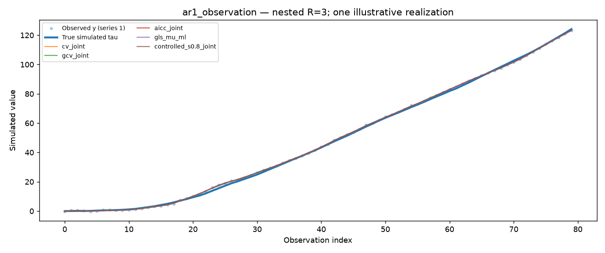
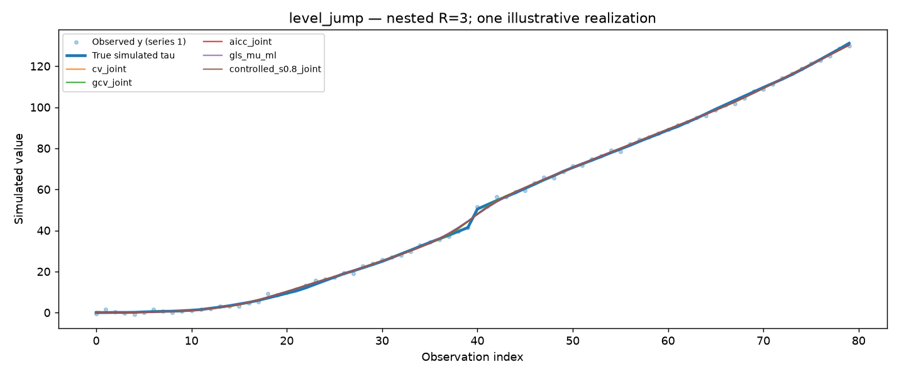
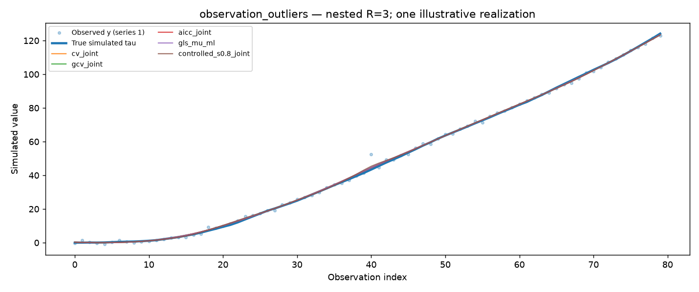
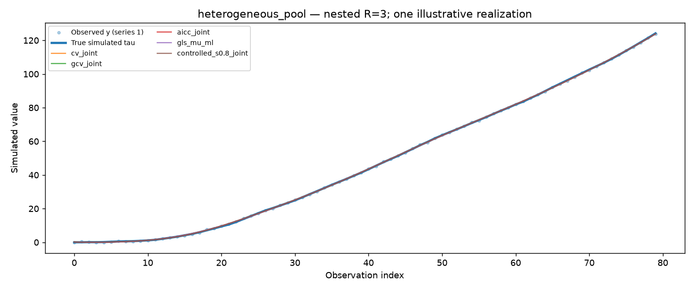

# Study M.2 — Results: 1,000 independent seeds across nine processes

**2026-10-19 — EXECUTED AND UPLOADED.** This document records actual observed numerical results of the *retrospective* Pooled LOOCV Numerical Optimization study (NOT horizon-h forecasting), not a proposed or fictitious experiment. It follows the [precommitted protocol](STUDY_M2_PROCESS_DIVERSITY_INDEPENDENT_SEEDS_2026-10-19.md) and the [single-example Study M.1 protocol](PROCESS_DIVERSITY_ILLUSTRATIVE_EXPERIMENT_2026-10-19.md).

## 0. Source provenance and independent checks

- Uploaded results commit: [47392dbc4d11ca63d2e856fc9d974e4a24a11021](https://github.com/heri-espino/Trend-Estimation/commit/47392dbc4d11ca63d2e856fc9d974e4a24a11021); **run's recorded source code SHA:** fda4e69d64d47675e5bd126bf7332aa22a3d68fc.
- Immutable source files: [manifest](../../../results/pooled_loocv_smoothness/process_examples/seed_study_1000_v1/manifest.json), [198-row risk table](../../../results/pooled_loocv_smoothness/process_examples/seed_study_1000_v1/risk_by_process_method.csv), [990 paired contrasts](../../../results/pooled_loocv_smoothness/process_examples/seed_study_1000_v1/paired_method_mse_differences.csv), [99 first-series pooling contrasts](../../../results/pooled_loocv_smoothness/process_examples/seed_study_1000_v1/paired_pooling_first_series.csv). [One-seed gallery winners](../../../results/pooled_loocv_smoothness/process_examples/gallery_001/illustrative_winners.csv) and PNG examples are also committed.
- Manifest **COMPLETE**, 40/40 chunks, exactly 1,000 new RNG seed offsets 1–1000 from base 20261019 (gallery offset 0 excluded); physical seeds 20261020–20262019. N=80; d=2; nested R={1,3}; nine paired mechanisms; eleven feasible methods; 198,000 per-method evaluations, 198 risk rows, 990 A-versus-B rows, 99 pooling rows. Python 3.11.16, NumPy 2.4.6, SciPy 1.17.1, 31-point score-grid search.
- **Independent compact-table algebraic checks:** each risk CI contains its reported mean; all per-process rankings complete; every one of the 990 paired contrasts equals the difference in reported method means (maximum discrepancy approximately 2.57×10^-16); all 99 pooling means equal R3 minus R1 means on the *same first series* (maximum discrepancy approximately 1.58×10^-16); paired CIs contain means; Holm-adjusted p values dominate nominal p values and are monotonic in raw p. **787/990** global Holm p values fall below .05, but this counts many intentionally bad fixed-smoothness comparisons and does NOT represent 787 independent research discoveries.
- [Reproducible compact-only audit](../../../experiments/pooled_loocv_smoothness/audit_process_monte_carlo_compact.py) added to the paper's lightweight CI. **Important boundary:** the 40 compressed per-seed shards are ignored by Git; neither this analysis nor the compact audit independently recomputed the underlying 198k fitted losses, uncertainty, or variance estimates from those raw files. Preserve a separate backup of the user's original gzip shards.

For method m, generating process c and seed j, the pooled true-trend reconstruction loss is

\[
L_{j,c,R,m}=\frac{1}{RN}\sum_{r=1}^{R}\sum_{t=1}^{N}
\left(\widehat{\tau}_{j,c,R,m,r,t}-\tau_{j,c,r,t}\right)^2,\quad
\widehat{\mathcal R}_{c,R,m}=\frac1{1000}\sum_{j=1}^{1000}L_{j,c,R,m}.
\]

**The independent Monte Carlo unit is the entire seed, not nine scenarios × two pool sizes × eleven methods.** The nine cases reuse common shocks within each seed; R1 is *literally* the first R3 series. For pairwise method inference, first calculate per-seed differences then their 95% Student-t intervals; p values are globally Holm-adjusted across **all 990 A/B comparisons**. Intervals remain pointwise, not familywise simultaneous. No true latent values are used in any feasible selector; simulated tau is for *ex-post* evaluation only.

## 1. Which policy has lowest mean reconstruction error?

The following are **mean MSE risk estimates conditional on these exact DGPs**, with the second-lowest method in parentheses. ML denotes the feasible Gaussian differenced-covariance likelihood; plug-in denotes a pooled observed-difference mean followed by *our* Gaussian variance ML, not Guerrero's published full estimator.

| Process | R1: best mean MSE (runner-up) | R3: best mean MSE (runner-up) | R3 winner vs runner-up, global Holm |
| --- | --- | --- | --- |
| Gaussian reference | plug-in ML **.09953** (zero-mu ML .10009) | plug-in ML **.09674** (GLS ML .09675) | **not distinguished**, p=1 |
| Smooth cycle | fixed S=.8 **.12217** (AICc zero .12588) | fixed S=.8 **.12327** (GCV zero .12353) | **not distinguished**, p=1 |
| Slope break | plug-in ML **.10779** (zero-mu ML .10953) | plug-in ML **.10642** (GLS ML .10644) | **not distinguished**, p=1 |
| True latent level jump | fixed S=.5 **.31674** (CV zero .35240) | fixed S=.5 **.31671** (GCV zero .33395) | **distinguished**, p≈1.46e-55 |
| Measurement outliers | joint AICc **.17469** (zero-mu ML .17772) | plug-in ML **.16961** (GLS ML .17028) | **not distinguished**, p=1 |
| AR1 observation noise (phi=.85) | fixed S=.8 **.49066** (joint AICc .52236) | fixed S=.8 **.49615** (joint AICc .52978) | **distinguished**, p numerically 0 |
| Time-changing observation variance | plug-in ML **.10249** (zero-mu ML .10296) | GLS ML **.09785** (plug-in ML .09787) | **not distinguished**, p=1 |
| Heterogeneous series variances | plug-in ML **.01697** (GLS ML .01701) | GLS ML **.13598** (plug-in ML .13619) | **not distinguished**, p=1 |
| Shared observation factor | plug-in ML **.10214** (zero-mu ML .10272) | GLS ML **.09827** (plug-in ML .09859) | **not distinguished**, p≈.834 |

At R3, **only two of nine first-vs-second rankings** are statistically distinguished under the global Holm correction. A numerical first-place rank should not be elevated into a model dominance claim when differences are 10^-5 to 10^-4. For example, Gaussian R3 plug-in minus GLS has mean -0.00001653 and pointwise 95% paired CI **[-0.00013802,+0.00010495]**, global p=1. At R1, winner-vs-runner-up is globally significant for the smooth cycle, slope break (adjusted p≈.0433), true level jump, AR1, and heterogeneous-first-series cases only.

The earlier gallery's one-seed ex-post winner agrees with the 1,000-seed mean-MSE first-place method in just **7/18** case–R combinations. That is a descriptive warning about picking methods from one fitted synthetic realization; it is not a formal 18-trial success rate.

## 2. Why do AR1 errors strongly change selected smoothing?

For stationary positively correlated Gaussian measurement errors, leaving out one y_t can leave strongly correlated neighbors in the training observations. Standard point-LOOCV can favor spurious local variation; the *IID observation covariance* assumed by Gaussian GLS also fails. The M.2 numerical pattern, **not a proof of exclusive causal mechanism**, is:

| R3 policy | Median nominal S | Mean true-tau MSE |
| --- | ---: | ---: |
| joint CV | .445 | .57850 |
| joint GCV | .422 | .58183 |
| joint AICc | .707 | .52978 |
| Gaussian GLS ML | .658 | .54295 |
| **analyst-fixed S=.8 with joint mu** | **.800** | **.49615** |

The fixed S=.8 minus joint CV difference is **-0.08235**, CI **[-0.08373,-0.08097]**; fixed S=.8 minus joint AICc **-0.03363**, CI **[-0.03438,-0.03288]**; fixed S=.8 minus GLS ML **-0.04680**, CI **[-0.04791,-0.04569]**. All three global Holm p<.05. Fixed S=.8 achieves the lowest realized loss in **100% of the 1,000 R3 draws** (95.7% of R1 draws) among these eleven policies. It was **predeclared**, not fitted from unknown real latent trend; neither S=.8 nor this result generalizes automatically beyond phi=.85 or the chosen noise scale.

## 3. What differs between genuine latent jumps and outliers in y?

The matched mechanisms intentionally separate jumps in the **true signal tau** from isolated spikes in the **observation error eta**:
- In level_jump, tau and y both have a genuine +7 step halfway through.
- In observation_outliers, tau is unchanged; only eta receives three ±8 spikes.

For a **true latent level jump**, fixed S=.5 gives R3 **.31671**, vs zero-mu GCV **.33395**, joint CV **.33641**, and GLS ML **.41371**. Fixed S=.5 minus the closest (zero-mu GCV) equals **-0.01724**, paired CI **[-.01920,-.01527]**, Holm p≈1.46e-55, with 63% ex-post per-seed win rate. The CV/GCV policies choose median S approximately .73 and Gaussian ML approximately .83: these smooth the discontinuity more strongly. PLS still penalizes abrupt jumps; its lower loss does **not** make it a changepoint detector.

Under **measurement-only outliers**, the preferred regime reverses: joint AICc R1 **.17469**, versus joint CV **.18348** and GLS ML **.28195**. Crucially R1 GLS has a long upper loss tail: median **.18289**, 90th percentile **.69367**, versus joint AICc median **.16665**, 90th percentile **.25455**. For R3, plug-in ML **.16961** and GLS ML **.17028** are not significantly different after global adjustment. The pooled MLE becomes much more stable on this fixed contamination pattern, but **neither method is a robust M-estimator**; all penalized fits remain quadratic.

## 4. Does pooling R3 improve an IDENTICAL first series?

The scientifically appropriate pooling estimand is the same-target seed-paired comparison

\[
\widehat\Delta_{\rm pool}(c,m)=
\frac1{1000}\sum_{j=1}^{1000}\left[
\frac1N\left\|\widehat\tau^{(1)}_{j,c,R3,m}-\tau^{(1)}_{j,c}\right\|^2
-\frac1N\left\|\widehat\tau^{(1)}_{j,c,R1,m}-\tau^{(1)}_{j,c}\right\|^2\right].
\]

**Negative helps, positive harms.** Avoid comparing pooled R3 *across-series average MSE* with R1, particularly when series have different true noise variances.

| Mechanism and policy | MSE on first series, R1 → R3 | Paired R3−R1 (95% pointwise CI) |
| --- | --- | --- |
| Gaussian reference, GLS ML | .11854 → .09538 | **−.02316** [−.02858,−.01774] |
| Gaussian reference, joint CV | .10946 → .09696 | **−.01250** [−.01571,−.00929] |
| Observation outliers, GLS ML | .28195 → .16703 | **−.11492** [−.13066,−.09918] |
| Shared observation factor, GLS ML | .11791 → .09843 | **−.01948** [−.02411,−.01484] |
| **Heterogeneous pool, GLS ML** | **.01701 → .04037** | **+.02336** [+.02237,+.02435] |
| **Heterogeneous pool, joint CV** | **.01851 → .03942** | **+.02090** [+.01976,+.02204] |
| Heterogeneous pool, fixed S=.8 | .01762 → .01761 | −.00001 [−.00003,+.00000] |
| AR1 noise, joint AICc | .52236 → .52441 | **+.00206** [+.00151,+.00260] |

The heterogeneous example uses observation-noise SDs **0.25/0.80/1.50** across its three series. The first is unusually clean. Under Gaussian GLS, median nominal S is **.758 for R1 and .888 for R3**; joint CV goes **.751→.888**. A single common lambda selected from the noisy combined pool **oversmooths the clean first series**. Under GLS, mean first-series error more than doubles from .01701 to .04037. Such a pooling reversal is the clearest *method-design warning* from the study. Fixed S=.8 changes very little because its lambda coordinate is not reselected from the other series.

A cross-series observation factor of correlation .70 does not eliminate pooling's benefit for GLS in this chosen DGP, though the independence assumption is false. Varying the correlation and adding a correct-covariance policy would be necessary to isolate its effect.

## 5. Other mechanisms and what they do NOT prove

**Sinusoidal smooth cycle:** fixed S=.8 R3 mean **.123268**, GCV zero **.123526**: the **nearest** gap has CI [−.000539,+.000025], Holm p=1. By contrast fixed S=.8 minus **joint** CV is **−.00248**, CI [−.00281,−.00216], significant under global Holm. One must distinguish zero-mean GCV from joint-mean CV. The sinusoid shifts fitted common mu away from .04: joint CV mean fitted mu ≈.0345 and pooled plug-in ≈.0291 (finite-sample constant difference-mean misspecification).

**Slope kink:** plug-in vs GLS R3 **.1064217 vs .1064428**, near tie (paired CI straddles zero, Holm p=1). Both improve on joint CV .10823 in this design.

**Changing observation variance:** GLS vs plug-in R3 **.097848 vs .097873**, near tie (paired CI straddles zero, Holm p=1). The single-series ordering differs; do not treat this as robust advantage of GLS to any arbitrary heteroskedasticity.

**Gaussian reference:** pooled plug-in and GLS R3 practically tie at .09674 and .09675, while joint CV yields .09843 and joint AICc .09889. In R1, Gaussian GLS mean loss .11854 is notably worse than plug-in .09953: the smaller pool changes finite-sample variance-component estimation.

**No universal fixed S:** S=.5 wins for the +7 true jump but is quite poor for Gaussian, cycle and heterogeneous pools. S=.8 wins for strongly positive AR1 errors but loses to fitted likelihood methods in Gaussian reference. The nominal normalized S is a lambda coordinate, not full joint-mean EDF.

## 6. Interpretation, limits and next scientific questions

**Conditional observations supported by data:** (i) likelihood/plug-in often tie very closely with three comparable series; (ii) stronger positive AR1 measurement dependence coincides with considerable CV/GCV undersmoothing; (iii) a real trend jump and a measurement-only outlier require different smoothing tradeoffs; (iv) equal-lambda pooling can markedly harm a cleaner individual series when series' noise scales differ; (v) a single illustrative seed often does not reveal the lowest Monte Carlo mean risk.

**Not established:** universal method dominance; a novel statistical theorem; exact global numerical minimization by multibracket search (Study L separate); causal isolation of CV's dependence failure without blocked CV and correct covariance ML; robust inference for financial markets; or actual future forecasting skill. DGP amplitudes are fixed, N=80 and d=2; the true latent trend is known **only in simulations**; methods/cases were selected after earlier research; pointwise intervals and global Holm p values apply to this design, not a new market population. Raw gzip shards remain on the user's machine, so remote source-to-raw-replication audit is still an open reproducibility task.

**Next priority, if extending the science:** vary *one mechanism parameter at a time*, not merely more seeds in the same nine cases. In particular: AR1 correlation phi in {0,.3,.6,.85} with blocked CV and correct-covariance GLS baselines; true-jump amplitude versus observation-outlier magnitude; and cross-series observation-variance ratios with inverse-variance weights or separate lambdas. Establish an analysis protocol and use fresh independent seed windows before any confirmatory claim.

**Current status:** Study M.1 single-seed gallery and Study M.2 1,000-seed matched-process study are **both executed and uploaded**. This dated note and the independent compact auditor supersede older prospective statements. Keep raw shards backed up; maintain results/decisions/handoffs. No PR, merge or main-branch change.
