<!-- _class: lead -->

# How should we choose trend smoothness? — Lecture V2

## A lecture on penalized least squares, pooled LOOCV and nine stochastic processes

**Extended master lecture with technical appendix | 1,000 seeds | 198,000 fits**

Heriberto Espino Montelongo · Research lecture, 19 October 2026

---

# Learning goals

By the end of this lecture, we should be able to:

1. Derive the penalized least-squares trend estimator.
2. Explain CV, GCV, AICc, and Gaussian covariance ML.
3. Understand **estimating a nonzero mean of differences**.
4. Reproduce the nine-process experiment and its paired comparisons.
5. Identify why **pooling sometimes helps and sometimes harms**.

> Our target is **retrospective latent-trend reconstruction**, not future forecasting.

---

# The central statistical question

Suppose we observe a noisy sequence

$$
y_t=\tau_t+\eta_t,\qquad t=1,\ldots,N.
$$

We want a smooth estimate of the **realized latent** trend $\tau$.

The difficulty is not merely computing an estimate. It is choosing **how strongly to smooth**.

- Too little smoothing: we follow measurement noise.
- Too much smoothing: we erase real movement and structural change.

---

<!-- _class: figure -->

# Concept: signal versus observations

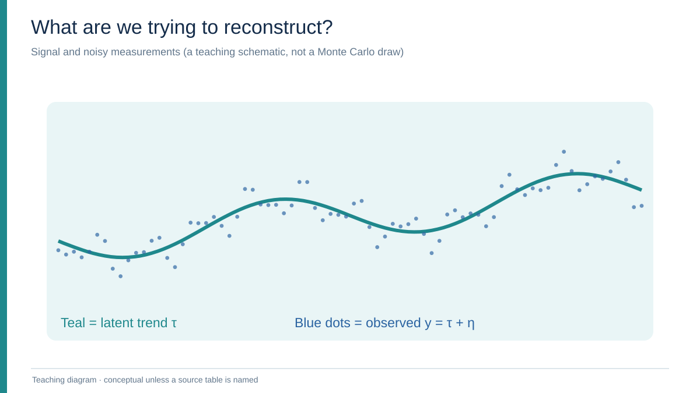

The observed series contains both the true simulated trend and observation errors. This figure is a schematic.

---

# What can we observe?

- We observe $y_t$, but **not** the underlying realized $\tau_t$.
- In a simulation, we deliberately generate and save both.
- In financial or economic applications, the true latent trend is generally **not available for evaluation**.

**Simulation advantage:** we can compare the chosen estimate directly with the realized simulated $\tau$, after selecting all parameters using only $y$.

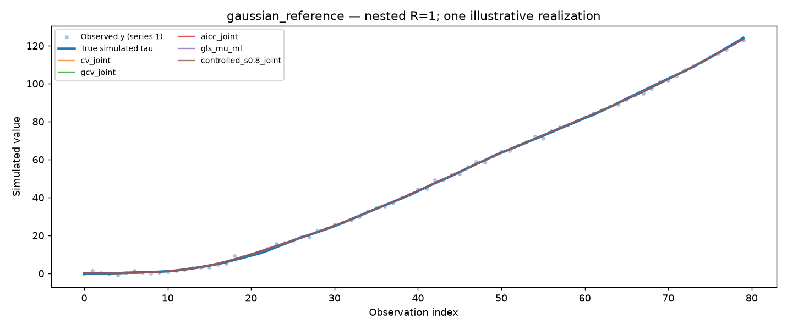

---

<!-- _class: divider -->

# Part I

## Penalized trend estimation: from assumptions to matrices

---

# Start with a roughness penalty

For an analyst-chosen difference order $d$, minimize

$$
J_\lambda(\tau)=\underbrace{\|y-\tau\|_2^2}_{\text{fit observations}}
+\lambda\underbrace{\|D_d\tau\|_2^2}_{\text{penalize changes}}.
$$

Here $D_d$ is the order-$d$ finite-difference matrix.

**Question:** what happens if the analyst changes $\lambda$?

- $\lambda=0$: interpolation of the observed series.
- $\lambda\to\infty$: restrict to the null space of $D_d$.

---

# Example: second differences

For $d=2$,

$$
(D_2\tau)_t=\tau_{t+2}-2\tau_{t+1}+\tau_t.
$$

Its matrix starts as

$$
D_2=
\begin{bmatrix}
1&-2&1&0&\cdots\\
0&1&-2&1&\cdots\\
\vdots&&\ddots&&\vdots
\end{bmatrix}.
$$

A zero second difference describes a **straight line**.

**Teaching interpretation:** penalizing $D_2\tau$ discourages rapid changes of slope.

---

<!-- _class: figure -->

# Visualizing the second-difference operator

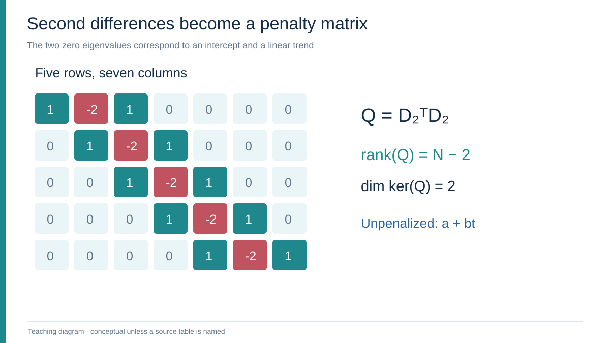

The unpenalized discrete polynomial space has dimension two when $d=2$.

---

# Why is the penalty matrix singular?

Define $Q=D_d^\top D_d$.

$$
x^\top Qx=\|D_dx\|^2\ge 0,
$$

so $Q$ is positive semidefinite.

Because all discrete polynomials of degree at most $d-1$ lie in $\ker(D_d)$,

$$
\operatorname{rank}(Q)=N-d,\qquad
\dim\ker(Q)=d.
$$

For $d=2$, the **two zero eigenvalues** correspond to an intercept and linear trend.

---

# Derive the solution

Differentiating the objective,

$$
\nabla_\tau J_\lambda
=-2(y-\tau)+2\lambda Q\tau=0.
$$

Therefore

$$
(I+\lambda Q)\widehat\tau_\lambda=y,
\qquad
\boxed{\widehat\tau_\lambda=H_\lambda y,}
$$

with

$$
H_\lambda=(I+\lambda Q)^{-1}.
$$

Unlike $Q$, the matrix $I+\lambda Q$ is invertible for $\lambda\ge 0$.

---

# Eigenvalues explain smoothing

Let $Q=U\operatorname{diag}(q_1,\ldots,q_N)U^\top$, where $q_j\ge0$.

Then

$$
H_\lambda
=U\operatorname{diag}\left(\frac{1}{1+\lambda q_j}\right)U^\top.
$$

- If $q_j=0$, that component is not shrunk.
- If $q_j$ is large, larger $\lambda$ suppresses it more.
- This connects a **roughness penalty** to **spectral filtering**.

The smoothing operator is linear for fixed $\lambda$ and fixed mean structure.

---

<!-- _class: figure -->

# Spectral effect of increasing lambda

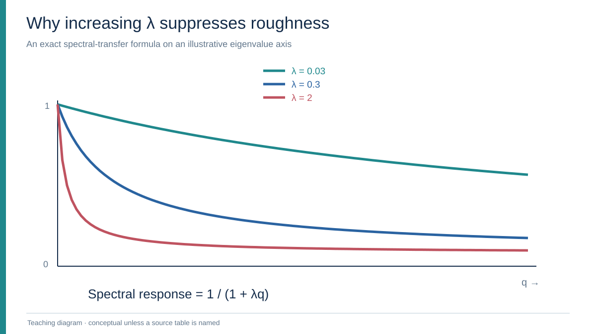

Positive roughness eigencomponents are attenuated by $1/(1+\lambda q)$.

---

# Trace and effective degrees of freedom

The fixed-mean smoother has

$$
\mathrm{df}(\lambda)=\operatorname{tr}(H_\lambda).
$$

From the eigenvalues,

$$
\operatorname{tr}(H_\lambda)
=d+\sum_{j=1}^{N-d}\frac{1}{1+\lambda q_j}.
$$

Thus

$$
\operatorname{tr}(H_0)=N,
\qquad
\operatorname{tr}(H_\infty)=d.
$$

**Interpretation:** increasing $\lambda$ reduces effective flexibility.

---

# A normalized smoothness coordinate

Following the paper's normalized convention,

$$
\boxed{S(\lambda)=
\frac{N-\operatorname{tr}(H_\lambda)}{N-d}}.
$$

This maps the smoothing range to $[0,1]$:

- $S=0$: no smoothing.
- $S=1$: projection onto the order-$d$ null space.

**Important:** with an estimated common difference mean, this nominal $S$ is **not** the full pooled effective degrees of freedom.

---

# Teaching question: what is selected?

Three independent decisions:

1. **Statistical score:** CV, GCV, AICc, likelihood or fixed $S$.
2. **Mean assumption:** impose $\mu=0$ or estimate one common $\mu$.
3. **Numerical optimizer:** scan, bounded refinement, multibracket, etc.

> Different scores and different optimizers must not be confused.

Study M.2 keeps the existing numerical selection implementation fixed. It does **not** establish which optimizer is best.

---

<!-- _class: divider -->

# Part II

## A nonzero mean of trend differences

---

# The stochastic-trend model

In the baseline data-generating model,

$$
D_d\tau_r=\mu\mathbf1+\varepsilon_r,
\qquad
y_r=\tau_r+\eta_r,
\quad r=1,\ldots,R.
$$

- $\mu$: a **common** expected $d$-th difference.
- $\varepsilon_r$: latent difference innovations.
- $\eta_r$: measurement or observation error.

For $d=2$, nonzero $\mu$ introduces a **quadratic mean component**.

This idea of nonzero difference means predates our work; the pooled joint fit is the branch's extension.

---

# Construct a particular polynomial

For indices $t=0,\ldots,N-1$, choose

$$
p_t=\binom{t}{d}
\quad\Longrightarrow\quad D_dp=\mathbf1.
$$

Then $\tau_r=\widetilde\tau_r+\mu p$ gives

$$
D_d\widetilde\tau_r=\varepsilon_r.
$$

**Question:** should we fix $\mu=0$, plug in observed differences, or estimate $\mu$ jointly?

We compare all three strategies using observed data only.

---

# Joint penalized fitting: the objective

Given a common unknown $\mu$, minimize

$$
\sum_{r=1}^{R}
\left(
\|y_r-\tau_r\|^2+
\lambda\|D_d\tau_r-\mu\mathbf1\|^2
\right).
$$

For fixed $(\lambda,\mu)$,

$$
\widehat\tau_r
=H_\lambda y_r+\mu(I-H_\lambda)p.
$$

Then **profile $\mu$ using the same observed pool**.

---

<!-- _class: small -->

# Derive the pooled mean profile, step by step

After minimizing over each trend, the profiled criterion has a quadratic dependence on $\mu$:

$$
\mathcal J_{\rm prof}(\mu)
=\lambda\sum_{r=1}^{R}(y_r-\mu p)^\top T_\lambda(y_r-\mu p).
$$

Differentiate (holding $\lambda$ fixed):

$$
\frac{\partial\mathcal J_{\rm prof}}{\partial\mu}
=-2\lambda\sum_r p^\top T_\lambda(y_r-\mu p)=0.
$$

Therefore $Rk_\lambda\widehat\mu=\sum_r b_\lambda^\top y_r$, yielding the next slide's formula.

---

# Profile the common difference mean

Define

$$
T_\lambda=QH_\lambda,\qquad
b_\lambda=T_\lambda p,\qquad
k_\lambda=p^\top T_\lambda p,
\quad
\bar y=\frac1R\sum_{r=1}^R y_r.
$$

The fitted mean is

$$
\boxed{
\widehat\mu_\lambda=
\frac{b_\lambda^\top\bar y}{k_\lambda}
}.
$$

This is a function of $\lambda$, so choosing the smoothing parameter also changes the fitted mean.

---

<!-- _class: small -->

# Where does the additional EDF come from?

Since $I-H_\lambda=\lambda QH_\lambda=\lambda T_\lambda$,

$$
\widehat\tau_r
=H_\lambda y_r+\lambda b_\lambda
\frac{b_\lambda^\top\bar y}{k_\lambda}.
$$

Thus the derivative of the $r$-th fitted series with respect to the $s$-th observed series is

$$
\frac{\partial\widehat\tau_r}{\partial y_s}
=\mathbf1_{\{r=s\}}H_\lambda
+\frac{\lambda}{Rk_\lambda}b_\lambda b_\lambda^\top.
$$

Taking the trace over the entire $RN\times RN$ smoother explains the extra low-rank degree of freedom on the next slide.

---

# Joint fitting changes the degrees of freedom

For the pooled fitted-mean model,

$$
\boxed{
\mathrm{EDF}_{\rm joint}(\lambda)
=R\operatorname{tr}(H_\lambda)
+\lambda\frac{\|b_\lambda\|^2}{k_\lambda}.
}
$$

Compare:

- Fixed $\mu$: effective dimension tends to $Rd$.
- One fitted common $\mu$: it tends to **$Rd+1$**.

It would be incorrect to use only $R\operatorname{tr}(H_\lambda)$ for pooled joint-mean GCV/AICc.

---

<!-- _class: divider -->

# Part III

## How do we choose the smoothness parameter?

---

# CV: delete one observation honestly

For fixed $\mu=0$ and a linear smoother, ordinary LOOCV uses

$$
\mathrm{CV}(\lambda)
=\frac1{RN}\sum_{r=1}^R\sum_{i=1}^N
\left(
\frac{y_{ri}-\widehat\tau_{ri}}
{1-(H_\lambda)_{ii}}
\right)^2.
$$

The familiar denominator corrects the in-sample residual for leverage.

**Key issue:** if $\mu$ is estimated, it must also be reestimated **without the deleted observation**.

---

<!-- _class: small -->

# Derive the fold-clean PRESS denominator

The fitted joint smoother has diagonal blocks

$$
\mathcal H_{rr}
=H_\lambda+\frac{\lambda}{Rk_\lambda}b_\lambda b_\lambda^\top.
$$

The leverage of observation $(r,i)$ is therefore

$$
\mathcal H_{(ri),(ri)}
=(H_\lambda)_{ii}+\frac{\lambda b_{\lambda,i}^2}{Rk_\lambda}.
$$

Using the standard linear-smoother leave-one-out identity

$$
e_{ri}^{(-ri)}
=\frac{y_{ri}-\widehat\tau_{ri}}
{1-\mathcal H_{(ri),(ri)}}
$$

and $I-H_\lambda=\lambda T_\lambda$ yields the exact joint PRESS expression on the next slide.

---

# Exact fold-clean CV with estimated mean

For positive finite $\lambda$, the existing derivation gives

$$
e_{ri}^{(-ri)}
=
\frac{
(T_\lambda y_r)_i-b_{\lambda,i}\widehat\mu_\lambda
}{
(T_\lambda)_{ii}-b_{\lambda,i}^2/(Rk_\lambda)
}.
$$

Therefore

$$
\boxed{
\mathrm{CV}_{\rm joint}(\lambda)
=\frac1{RN}\sum_{r,i}\left(e_{ri}^{(-ri)}\right)^2.
}
$$

The same exact deletion-honest objective works across the pooled series, with one common fitted $\mu$.

---

# GCV: replace individual leverage by average leverage

Let $\mathrm{RSS}=\sum_{r,i}(y_{ri}-\widehat\tau_{ri})^2$ and $M=RN$.

The implementation uses

$$
\boxed{
\mathrm{GCV}(\lambda)
=\frac{\mathrm{RSS}/M}
{\left(1-\mathrm{EDF}_{\rm total}/M\right)^2}
}.
$$

- More economical surrogate for ordinary LOOCV.
- Depends on a valid model-wide EDF.
- Can behave differently when observations are autocorrelated.

The score is not a known-latent-trend MSE.

---

# AICc: in-sample fit with a complexity correction

In this codebase, for $M=RN$ and $\mathrm{df}=\mathrm{EDF}_{\rm total}$,

$$
\boxed{
\mathrm{AICc}(\lambda)=
\log(\mathrm{RSS}/M)
+\frac{2\,\mathrm{df}+1}{M-\mathrm{df}-2}.
}
$$

It is undefined when $M-\mathrm{df}\le2$.

The precise convention follows our implementation of the Cortés-Toto et al. (2017) criterion, extended to pooled observations and fitted common mean.

---

# What about BIC?

The broader branch compares CV, GCV, AICc and BIC.

However, the particular implemented BIC score has

$$
\log(\mathrm{RSS}/M)+
\mathrm{df}\frac{\log M}{M}.
$$

As $\lambda\downarrow0$, the smoother interpolates and $\mathrm{RSS}\to0$.

**Consequence:** the raw log-RSS term can drive this score to the interpolation boundary. Its numerical lower-bound behavior should not be interpreted as an unconstrained optimum.

**Study M.2 therefore uses the 11 feasible policies shown next, not BIC.**

---

# Gaussian covariance maximum likelihood

From the difference model,

$$
z_r=D_dy_r,\qquad
\operatorname{Cov}(z_r)
=\sigma_\varepsilon^2I+
\sigma_\eta^2D_dD_d^\top.
$$

Estimate variance components from **observed differences**, and set

$$
\widehat\lambda=
\frac{\widehat\sigma_\eta^2}
{\widehat\sigma_\varepsilon^2}.
$$

The branch also has a Gaussian GLS estimate of $\mu$ and a pooled observed-difference plug-in alternative.

These are quasi-likelihood approaches when the assumed covariance is wrong.

---

# The eleven feasible policies

| Mean structure | Criterion or policy |
|---|---|
| Imposed $\mu=0$ | CV, GCV, AICc, Gaussian difference ML |
| Joint fitted $\mu$ | CV, GCV, AICc |
| Joint fitted $\mu$ | Gaussian GLS mean + variance ML |
| Pooled observed-difference plug-in $\mu$ | Plug-in mean + our Gaussian variance ML |
| Joint fitted $\mu$ | Preset $S=0.5$, preset $S=0.8$ |

**Total: 11.**

No method is permitted to use the simulated true $\tau$ when selecting $\mu$ or $\lambda$.

---

# Historical attribution

**Existing work:** Guerrero's stochastic-trend framework allows a nonzero mean of differences. Cortés-Toto, Guerrero and Reyes (2017) study alternative optimality criteria for penalized trend smoothness.

**This project's implementation:** pooled common-$\lambda$ comparisons across $R$ series, fitted common-$\mu$ formulas, exact fold-clean pooled PRESS, and the nine-process simulation experiment.

Our experiments do **not** demonstrate that every one of these components is novel in the global literature.

---

<!-- _class: divider -->

# Part IV

## Designing the experiments: change the process, then replicate

---

# First: deliberately generate the latent truth

The default baseline of Study M.2 is

$$
N=80,\quad d=2,\quad
\mu=0.04,\quad
\sigma_\varepsilon=0.12,\quad
\sigma_\eta=0.80.
$$

We generate **three** latent integrated trends and observation-noise sequences using a common Gaussian random source.

For the reference:

$$
\varepsilon_{rt}\sim N(0,0.12^2),
\quad\eta_{rt}\sim N(0,0.80^2).
$$

The other eight examples change the signal, the noise, or the pooling assumptions.

---

# Nine processes, three mechanisms of departure

| Signal shape changes | Observation errors change | Pooling structure changes |
|---|---|---|
| Smooth sinusoidal cycle | Isolated outliers | Unequal series noise SD |
| Change in slope | AR(1) correlation | Common observation shock |
| True level jump | Variance regime switch | Gaussian reference baseline |

Each case holds as much of the **underlying random draw** fixed as possible while modifying the named mechanism.

This makes process-to-process comparisons paired, not independent.

---

# Gallery 01: correctly specified Gaussian reference

A single simulated realization reveals the difference between fitted trend lines. **It cannot estimate expected reconstruction risk.**

---

# Gallery 02: smooth cycle

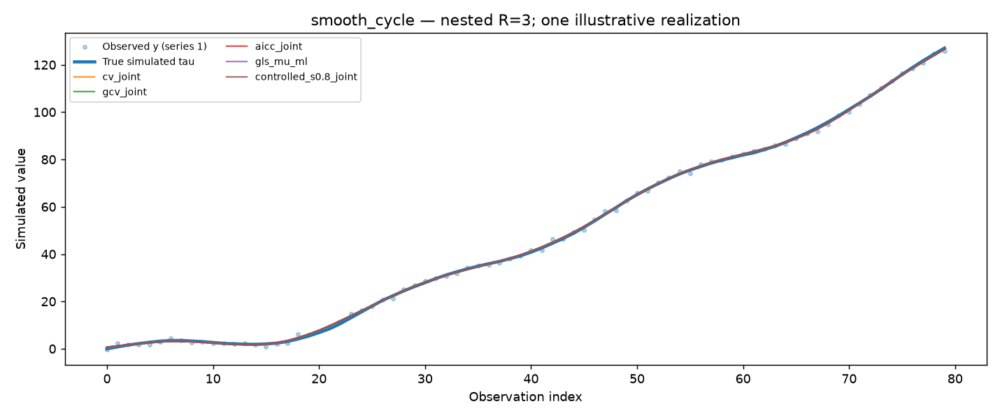

The sinusoidal addition changes the mean structure of second differences. Oversmoothing can erase genuine oscillations.

---

# Gallery 03: change in slope

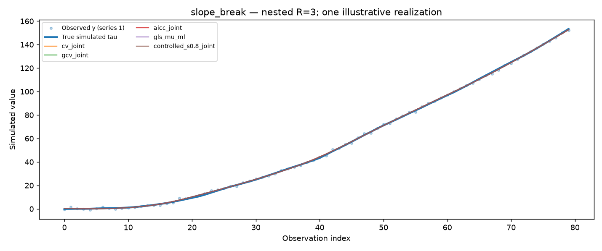

The generating signal acquires a kink: a deterministic change in slope halfway through the observed interval.

---

# Gallery 04: true level jump

This is a **jump in the simulated latent trend itself**. The correct reconstruction should respond to it, not remove it as noise.

---

# Gallery 05: observation-only outliers

Here the realized latent trend has **no added jump**: only selected observed measurements are contaminated.

---

# Gallery 06: autocorrelated measurement noise

Observation noise is generated as stationary AR(1), with $\phi=0.85$. Adjacent errors carry related information.

---

# Gallery 07: change in observation variance

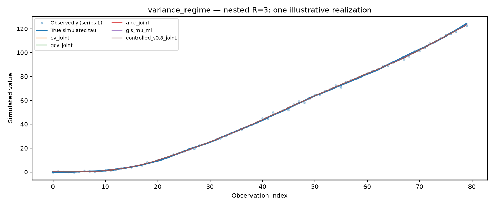

The observation-error scale is multiplied by 0.45 in the first half and 1.35 in the second half.

---

# Gallery 08: unequal noise across pooled series

The three observation-noise standard deviations are **0.25, 0.80 and 1.50**. Should one common smoothing parameter fit all three?

---

# Gallery 09: shared observation shocks

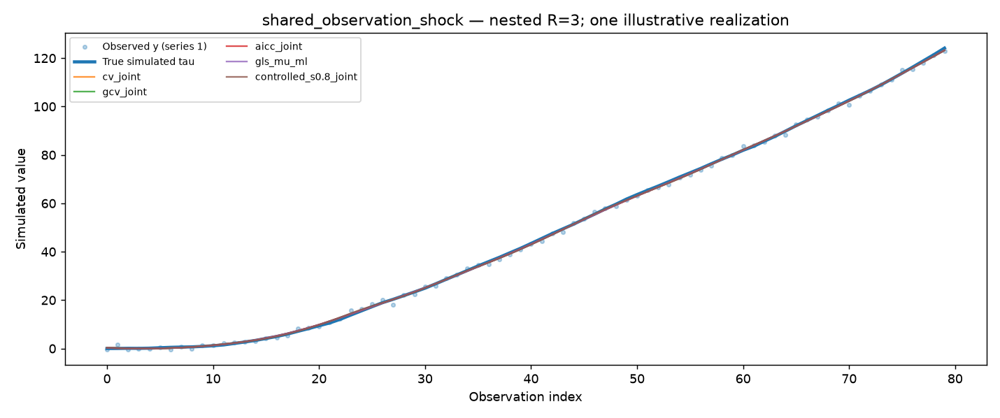

The observation errors share a common factor; the resulting cross-series noise correlation is **0.70**.

---

# Why we did not stop after nine pictures

The illustrated seed may show one method winning **by chance**.

The initial gallery used one seed and produced

$$
9\text{ mechanisms}\times2\text{ pool sizes}\times11\text{ methods}
=\boxed{198\text{ evaluations}}.
$$

We then fixed the processes and policies and asked a more reliable question:

> Which procedures have lower **mean reconstruction error** over independent repetitions?

---

# The 1,000-seed design

Study M.2 uses 1,000 **new** seed indices. Within each:

- Draw one underlying innovation pool.
- Apply all nine paired process modifications.
- Evaluate both $R=1$ and $R=3$ on nested series.
- Fit all 11 policies without access to true $\tau$.
- Save realized latent reconstruction losses.

$$
1000\times9\times2\times11
=\boxed{198{,}000\text{ method evaluations}}.
$$

There are **1,000 independent seed units**, not 198,000 independent data draws.

---

<!-- _class: figure -->

# Anatomy of a single simulation seed

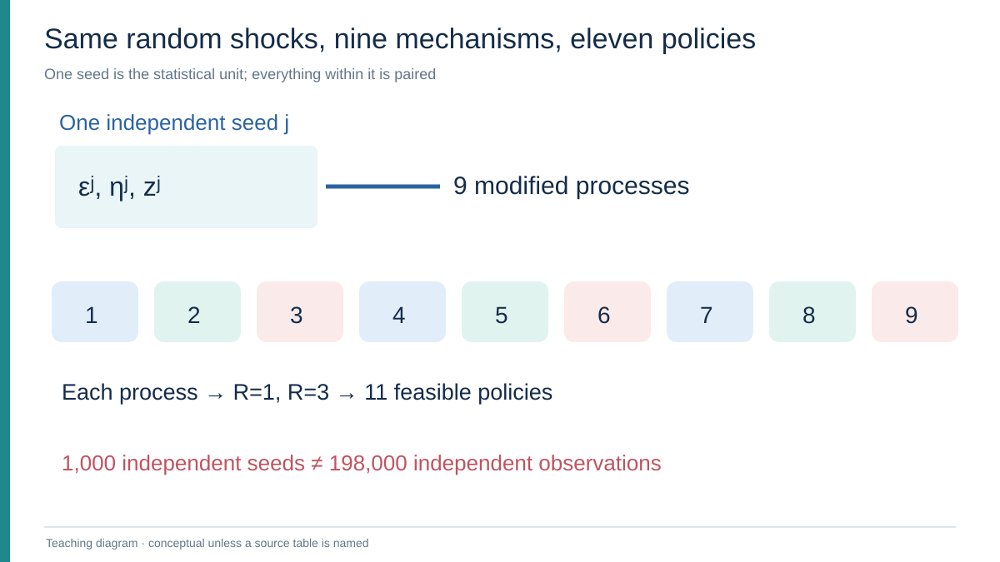

The nine mechanisms and both pool sizes share their underlying seed-specific shocks.

---

# What do we measure?

For seed $j$, process $c$, pool size $R$, and policy $m$,

$$
L_{j,c,R,m}=
\frac1{RN}\sum_{r=1}^{R}\sum_{t=1}^{N}
(\widehat\tau_{j,c,R,m,r,t}-\tau_{j,c,r,t})^2.
$$

The estimated conditional reconstruction risk is

$$
\boxed{\widehat{\mathcal R}_{c,R,m}
=\frac1{1000}\sum_{j=1}^{1000}L_{j,c,R,m}.}
$$

Also report MAE, median MSE, 90th-percentile MSE, fitted $\mu$ and selected $S$.

---

# Why paired comparisons?

Within seed $j$, every method sees the same simulated observations.

For methods $A,B$, form

$$
\delta_j=L_{j,c,R,A}-L_{j,c,R,B}
$$

and then estimate

$$
\widehat\Delta_{A-B}=\frac1{1000}\sum_{j=1}^{1000}\delta_j.
$$

Negative values favor $A$.

A confidence interval for **paired differences** is usually more informative than comparing two unrelated marginal intervals.

---

# What does Holm correction do?

There are

$$
9\times2\times\binom{11}{2}=\boxed{990}
$$

method pairs.

We compute nominal paired $t$-test p-values, then apply **one global Holm adjustment** over the 990 comparisons.

- Pointwise 95% confidence intervals remain pointwise.
- The adjusted p-values address multiplicity for this reported family.
- A statistically detectable difference may be **practically tiny**.

The aggregate audit found 787/990 adjusted p-values below 0.05; many reflect obviously poor fixed-$S$ alternatives, **not 787 independent discoveries**.

---

<!-- _class: divider -->

# Part V

## Study M.2: reading the actual results

---

<!-- _class: figure -->

# All nine mechanisms — R = 1

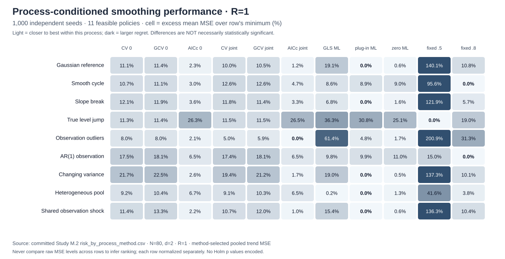

Percentage excess mean-MSE above the best mean-MSE policy **within the same process**. **Color does not encode statistical significance.**

---

<!-- _class: figure -->

# All nine mechanisms — R = 3

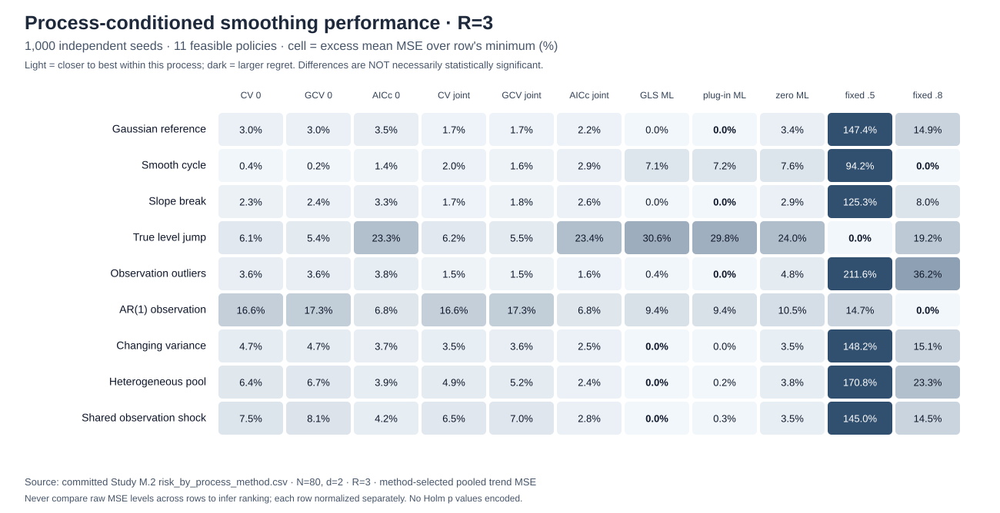

The apparent winner changes across processes. The figure compares **relative regret**, not raw MSE on a common scale.

---

<!-- _class: tight -->

# Lowest mean MSE in each process, R=1

| Process | First-place policy | Mean MSE |
|---|---|---:|
| Gaussian reference | Pooled plug-in + ML | **0.09953** |
| Smooth sinusoid | Preset $S=.8$ | **0.12217** |
| Slope break | Pooled plug-in + ML | **0.10779** |
| True latent jump | Preset $S=.5$ | **0.31674** |
| Observation outliers | Joint AICc | **0.17469** |
| AR(1) observations | Preset $S=.8$ | **0.49066** |
| Changing variance | Pooled plug-in + ML | **0.10249** |
| Unequal pool noise | Pooled plug-in + ML | **0.01697** |
| Shared observation shock | Pooled plug-in + ML | **0.10214** |

**These are sample risk minima; significance must be tested separately.**

---

<!-- _class: tight -->

# Lowest mean MSE in each process, R=3

| Process | First-place policy | Mean MSE |
|---|---|---:|
| Gaussian reference | Pooled plug-in + ML | **0.09674** |
| Smooth sinusoid | Preset $S=.8$ | **0.12327** |
| Slope break | Pooled plug-in + ML | **0.10642** |
| True latent jump | Preset $S=.5$ | **0.31671** |
| Observation outliers | Pooled plug-in + ML | **0.16961** |
| AR(1) observations | Preset $S=.8$ | **0.49615** |
| Changing variance | Gaussian GLS/ML | **0.09785** |
| Unequal pool noise | Gaussian GLS/ML | **0.13598** |
| Shared observation shock | Gaussian GLS/ML | **0.09827** |

**R3 GLS/ML and plug-in ML often differ by only $10^{-5}$–$10^{-4}$ MSE.**

---

# A first-place rank can be an almost exact tie

In the Gaussian baseline at $R=3$:

| Policy | Mean latent MSE |
|---|---:|
| Pooled plug-in mean + ML | **0.0967383** |
| Gaussian GLS/ML fitted mean | **0.0967548** |
| Joint CV | 0.098430 |
| Joint AICc | 0.09889 |

Plug-in minus GLS:

$$
\widehat\Delta=-0.00001653
$$

95% paired CI: **[−0.00013802, +0.00010495]**. Global Holm-adjusted $p=1$.

**Conclusion:** practically and statistically indistinguishable in this design.

---

<!-- _class: figure -->

# How much better is first place?

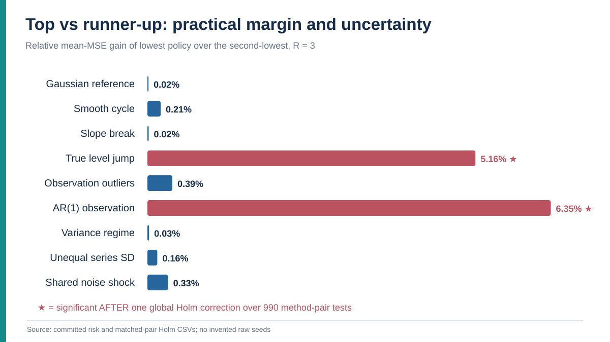

Top-two mean-risk differences are often small and not globally Holm-significant.

---

# Which R3 top-vs-second differences survive Holm?

Only two of the nine sample first places are clearly separated from the nearest competitor after global Holm adjustment:

- **True latent level jump:** preset $S=.5$ beats zero-mean GCV.
- **AR(1) observation errors:** preset $S=.8$ beats joint AICc.

For the other seven, the top-two gap is not familywise significant.

> "Rank 1" is an empirical ordering, not a theorem or a universal recommendation.

---

# A genuine jump rewards less smoothing

Under the +7 **true level jump**, $R=3$:

| Policy | Mean MSE | Median nominal $S$ |
|---|---:|---:|
| **Preset $S=.5$** | **0.31671** | .500 |
| GCV, $\mu=0$ | 0.33395 | .727 |
| Joint CV | 0.33641 | .734 |
| Gaussian GLS/ML | 0.41371 | .827 |

Preset $S=.5$ minus zero-mean GCV:

$$
-0.01724,\qquad95\%\ \mathrm{CI}=[-0.01920,-0.01527].
$$

The distinction survives global Holm adjustment.

---

<!-- _class: figure -->

# A true jump favors less smoothing

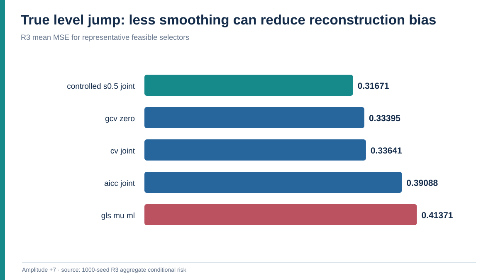

Mean MSE under the specified +7 latent level jump; this is not a universal optimality claim.

---

<!-- _class: figure -->

# The genuine jump, illustrated

For a **true structural jump**, aggressive global smoothing introduces substantial bias near the discontinuity.

---

# An observation spike is a different problem

In the outlier case, the true trend is not changed.

Under $R=1$:

| Policy | Mean MSE | 90th percentile MSE |
|---|---:|---:|
| **Joint AICc** | **0.17469** | 0.25455 |
| Joint CV | 0.18348 | 0.27232 |
| Gaussian GLS/ML | 0.28195 | **0.69367** |

The single-series Gaussian ML estimator suffers some very poor realizations.

**Do not confuse smoothing under contaminated observations with explicit robust regression.** None of these is a robust M-estimator.

---

<!-- _class: figure -->

# Outliers expose tail risk

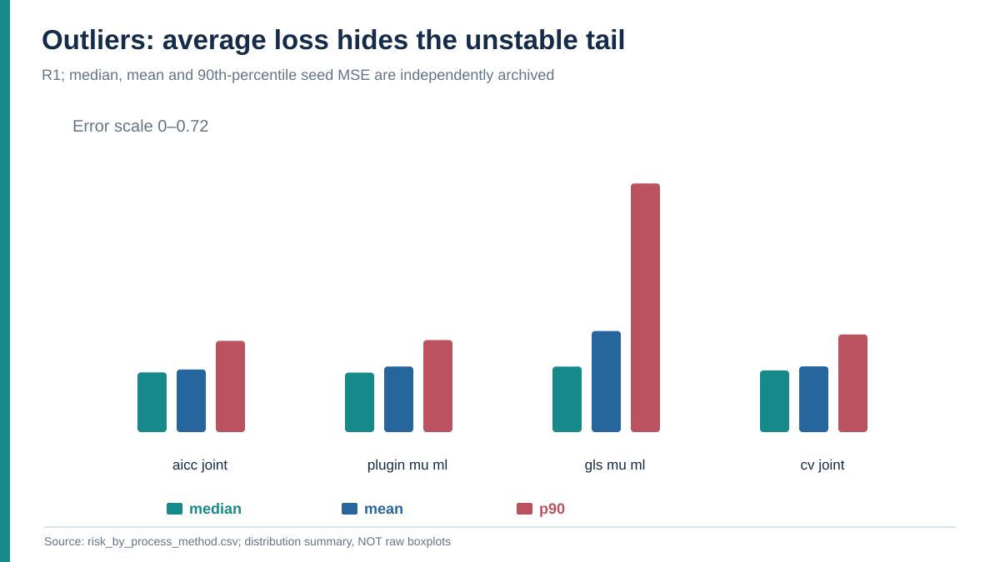

Compare median, mean and 90th percentile MSE: GLS single-series fits have a heavier loss tail.

---

<!-- _class: figure -->

# Observation outliers, illustrated

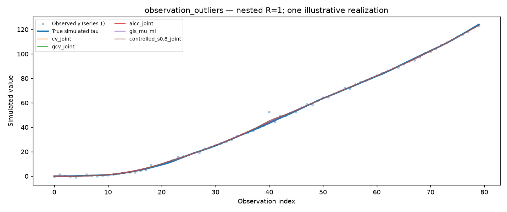

Compare with the preceding true-jump slide. The same kind of sharp visual disturbance can demand the **opposite** inferential decision.

---

# Strongly autocorrelated noise changes the game

For AR(1) measurement errors with $\phi=.85$, $R=3$:

| Policy | Median $S$ | Mean MSE |
|---|---:|---:|
| Joint GCV | .422 | 0.58183 |
| Joint CV | .445 | 0.57850 |
| Gaussian GLS/ML | .658 | 0.54295 |
| Joint AICc | .707 | 0.52978 |
| **Preset $S=.8$** | **.800** | **0.49615** |

Joint point-LOOCV follows correlated observation fluctuations too closely **in this DGP**.

---

<!-- _class: figure -->

# AR(1) selected smoothness versus risk

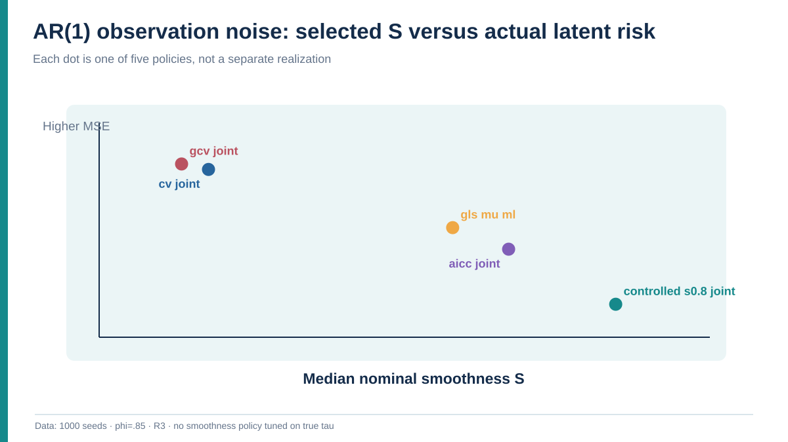

Under autocorrelated errors, the chosen nominal smoothness strongly influences reconstruction error.

---

# The AR(1) advantage is large

Under $R=3$, relative to preset $S=.8$:

- Joint CV has **0.08235 higher** mean MSE.
- Joint AICc has **0.03363 higher** mean MSE.
- Gaussian GLS/ML has **0.04680 higher** mean MSE.

All three paired differences remain significant after Holm correction.

Preset $S=.8$ is the lowest realized-MSE policy in **100% of the 1,000 R3 seeds** among the eleven policies tested.

This does **not** establish that $S=.8$ is generally optimal at other correlation levels.

---

<!-- _class: figure -->

# AR(1) example: reconstructed curves

A method can fit observed $y$ well but reconstruct the **latent** $\tau$ poorly when measurement errors are serially dependent.

---

# How do smooth cycles differ?

For the sinusoidal trend at $R=3$:

- Preset $S=.8$: mean MSE **0.123268**.
- Zero-mean GCV: mean MSE **0.123526**.

Their paired CI includes zero; global Holm $p=1$.

However, preset $S=.8$ versus **joint** CV has difference **−0.00248**, CI [−0.00281,−0.00216], significant after Holm.

**Lesson:** estimating a mean of differences is a modeling choice; it can interact with periodic misspecification.

---

# What did we learn about estimating μ?

Joint mean estimation adds a degree of freedom, and the fitted mean changes with $\lambda$.

- In the Gaussian reference, mean fitted $\mu$ is close to the baseline **0.04**.
- In the smooth-cycle case, joint CV fitted mean averages approximately **0.0345**.
- The pooled observed-difference plug-in averages approximately **0.0291** in that cycle case.

The constant-$D_2$-mean assumption is not literally true after adding the sinusoid.

**We should not claim that joint fitting is always superior to $\mu=0$.**

---

<!-- _class: divider -->

# Part VI

## Pooling: when does three-series fitting help?

---

# Define the SAME-series pooling comparison

Let $\widehat\tau^{(1)}_{R=1}$ be estimated from the first series alone and $\widehat\tau^{(1)}_{R=3}$ from all three series.

We compare

$$
\boxed{
\widehat\Delta_{\rm pool}
=\frac1{1000}\sum_{j=1}^{1000}
\left[
\frac{\|\widehat\tau^{(1)}_{R=3,j}-\tau^{(1)}_j\|^2}{N}
-\frac{\|\widehat\tau^{(1)}_{R=1,j}-\tau^{(1)}_j\|^2}{N}
\right].
}
$$

- **Negative:** pooling helps the first series.
- **Positive:** pooling harms the first series.

Do not compare R3 *average across three series* against R1 when their noise levels differ.

---

<!-- _class: figure -->

# Pooling changes lambda, not the first series

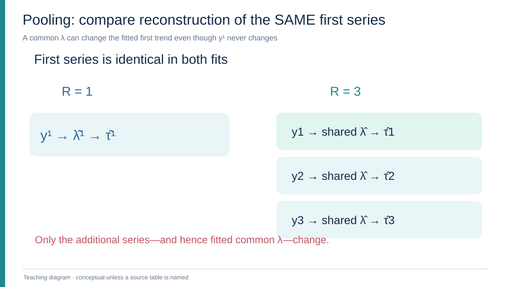

The first observed sequence is held identical when comparing R1 and R3.

---

<!-- _class: figure -->

# Pooling effects across nine processes

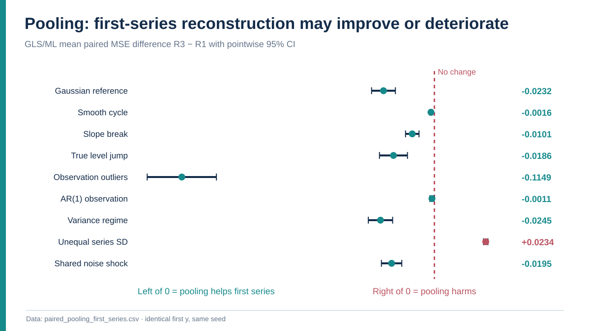

GLS first-series paired differences: negative means pooling helps; positive means harm.

---

<!-- _class: tight -->

# Pooling effects on the identical first series

| Process / policy | R1 first MSE | R3 first MSE | Difference (R3−R1) |
|---|---:|---:|---:|
| Gaussian / GLS ML | 0.11854 | 0.09538 | **−0.02316** |
| Gaussian / joint CV | 0.10946 | 0.09696 | **−0.01250** |
| Outliers / GLS ML | 0.28195 | 0.16703 | **−0.11492** |
| Shared shock / GLS ML | 0.11791 | 0.09843 | **−0.01948** |
| Unequal SD / GLS ML | **0.01701** | **0.04037** | **+0.02336** |
| Unequal SD / joint CV | 0.01851 | 0.03942 | **+0.02090** |
| AR(1) / joint AICc | 0.52236 | 0.52441 | **+0.00206** |

These are paired mean errors; the full 99-row file also contains pointwise intervals and win fractions.

---

# The strongest warning: heterogeneous pooling

One common smoothing parameter is fitted to three series with measurement-noise SDs

$$
(\sigma_{\eta,1},\sigma_{\eta,2},\sigma_{\eta,3})
=(0.25,\ 0.80,\ 1.50).
$$

The **cleanest** series is the first.

Using GLS/ML:

$$
\mathrm{MSE}_{R=1}=0.01701,\qquad
\mathrm{MSE}_{R=3}=0.04037.
$$

Its paired deterioration is **+0.02336**, pointwise 95% CI **[+0.02237,+0.02435]**.

---

# Why does the first-series MSE grow?

For the heterogeneous case:

- GLS/ML median nominal $S$ changes from **0.758** at R1 to **0.888** at R3.
- Joint CV's median $S$ changes from **0.751** to **0.888**.

The two noisier series drive the **common** parameter toward heavier smoothing.

A parameter good for the pooled sample is not necessarily good for the lowest-noise member.

> Pooling may reduce estimation variability while increasing mismatch bias.

---

<!-- _class: figure -->

# Identical first-series MSE before and after pooling

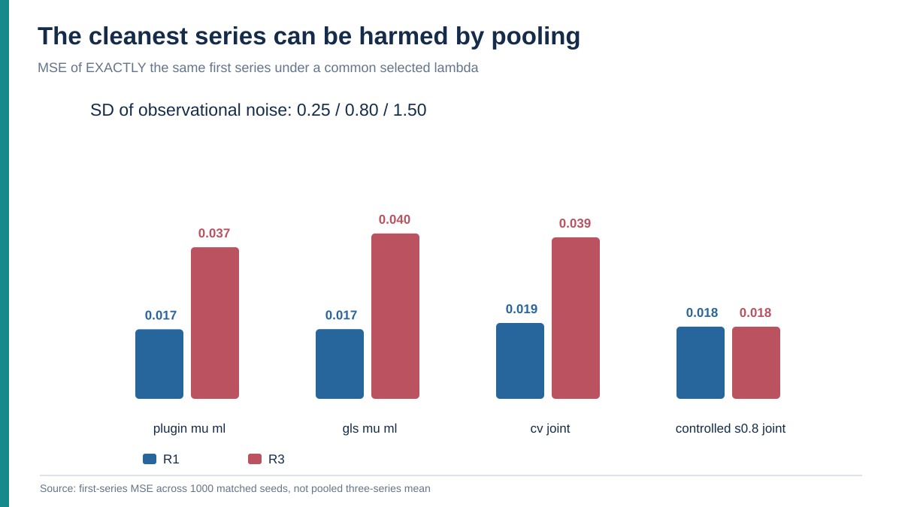

The cleanest observed series can be oversmoothed after pooling with noisier series.

---

<!-- _class: figure -->

# Heterogeneous pooling, illustrated

The qualitative question is not "does pooling help on average?" but "**which series benefits, and which gets damaged?**"

---

# Shared noise is not the same as unequal noise

For observation-noise correlation **0.70** across series, GLS/ML:

$$
\mathrm{MSE}_{R=1}^{(1)}=0.11791,
\qquad
\mathrm{MSE}_{R=3}^{(1)}=0.09843.
$$

The paired improvement is **−0.01948**, pointwise CI **[−0.02411,−0.01484]**.

This example still gains from pooling despite a violated independence assumption.

**It does not prove pooling is safe for every cross-series dependence structure.**

---

<!-- _class: divider -->

# Part VII

## Interpretation, uncertainty and next research questions

---

# One seed versus 1,000 seeds

The best method by **realized MSE in the single-seed gallery** matched the lowest **mean MSE over 1,000 independent seeds** in only

$$
\boxed{7\text{ of }18\text{ process–pool combinations}}.
$$

This is **descriptive agreement**, not a significance test or 18 independent trials.

The more interesting output is the *risk difference across independent seeds*, with uncertainty.

---

<!-- _class: figure -->

# One-seed winners versus 1,000-seed mean winners

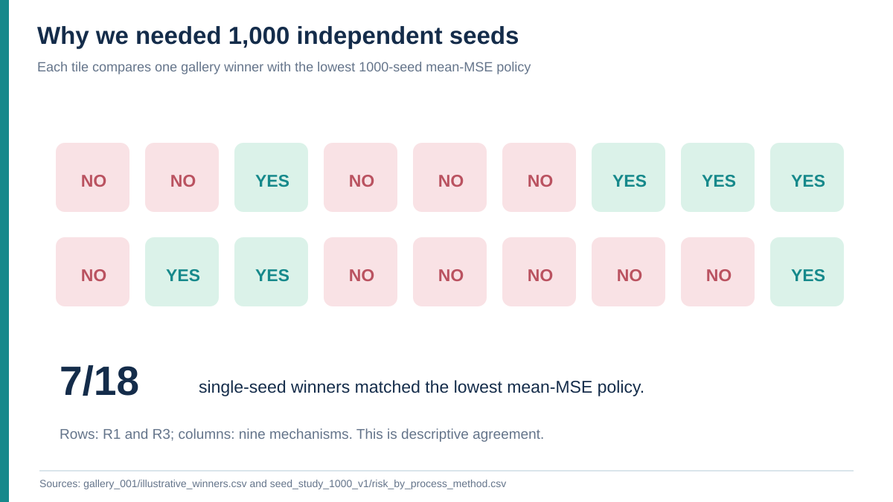

Only 7 of 18 single-gallery first places match the lowest 1,000-seed mean risk.

---

# What is robustly supported?

Within these nine specified data-generating mechanisms:

1. **AR(1) measurement noise** leads ordinary point-CV/GCV to select weaker smoothing than the fixed-$S$ policy that attains lower latent MSE.
2. A **real structural level jump** favors less smoothing than regular Gaussian likelihood in this setup.
3. **Gaussian GLS/ML versus pooled plug-in ML** is frequently a near tie when R=3.
4. **Pooling with a common parameter can harm a cleaner series** if the pooled noise levels differ strongly.

None is a claim of universal statistical dominance.

---

# What this experiment does NOT establish

- How to forecast future prices or returns at horizon $h$.
- Which method recovers the **true real-world** latent financial trend.
- A method that detects structural breaks or robustly rejects outliers.
- A universally optimal $\lambda$ or $S$.
- Guaranteed global numerical minimization by the score-grid optimizer.
- Full independent reaggregation of 198k raw rows: those compressed shards remain user-local.

The evidence is conditional on $N=80$, $d=2$, specified amplitudes and noise mechanisms.

---

# What is the next meaningful experiment?

A **one-factor sensitivity analysis**, not more identical-case seeds:

1. Sweep measurement-error AR(1) correlation $\phi$, add blocked CV or correctly specified covariance baselines.
2. Vary **latent jump size** separately from **outlier size**.
3. Vary **across-series noise ratios** and compare common $\lambda$ against weighted or series-specific smoothing.

These target mechanisms suggested by the completed study; they are **not yet executed results**.

---

# Reproducibility: what is actually on GitHub?

- One-seed gallery: **18 trajectory figures**, 198 method evaluations.
- Study M.2: **1,000 independent seeds**, 198,000 method evaluations.
- Committed aggregates: **198 risk rows, 990 method pairs, 99 pooling effects**.
- Manifest: **COMPLETE**, 40/40 seed chunks, with source SHA and software versions.
- Independent compact-table consistency audit: **passed**.

The raw compressed per-seed shards are *excluded from Git*. **Back them up locally** if full row-level reaggregation is required.

---

# Discussion questions for the audience

1. Would blocked CV reduce the apparent AR(1) undersmoothing?
2. Should the smoothing penalty itself adapt to a genuine jump?
3. When should a series receive its own $\lambda$, rather than a pooled one?
4. Can we estimate measurement-error covariance sufficiently accurately to guide pooling?
5. How could we evaluate these choices when **no true latent trend is observed**?

---

<!-- _class: lead -->

# Main takeaway

**There is no universal smoothness selector.**

The choice depends on the latent trend's structure, the observation error's dependence, and the validity of pooling assumptions.

**Statistical objective, mean model, numerical optimizer and evaluation target are different things.**

---

<!-- _class: tight -->

# Source notes and reproducibility

- **Study M.2 results:** notes/STUDY_M2_1000_SEED_PROCESS_RESULTS_2026-10-19.md
- **M.2 design:** notes/STUDY_M2_PROCESS_DIVERSITY_INDEPENDENT_SEEDS_2026-10-19.md
- **Nine-process generator:** experiments/pooled_loocv_smoothness/run_process_examples.py
- **Seeded runner:** experiments/pooled_loocv_smoothness/run_process_monte_carlo.py
- **Mathematical methods:** experiments/pooled_loocv_smoothness/cortes_optimality_criteria.py
- **Committed data:** results/pooled_loocv_smoothness/process_examples/seed_study_1000_v1/
- **Literature anchors:** Guerrero (2007); Cortés-Toto, Guerrero and Reyes (2017).

The full paths and stable source code SHA are documented in the accompanying presentation README and research notes.

---
<!-- _class: lead -->

# Lecture V2 — Technical appendix

**Formal derivations, diagnostics, case-by-case tables and discussion exercises**

Main lecture first; appendix slides can be shown as needed.

---

<!-- _class: divider -->

# Appendix A

## Linear algebra: proofs behind penalized smoothing

---

# A1 — General finite differences

For integer $d\ge1$, the forward difference operator is

$$
(D_d x)_t=\sum_{j=0}^d(-1)^{d-j}{d\choose j}x_{t+j}.
$$

The matrix is $(N-d)\times N$. It has bandwidth $d+1$.

**Question:** why does this definition produce $d$ unpenalized polynomial directions?

---

# A2 — The kernel of D₁

For first differences,

$$
(D_1x)_t=x_{t+1}-x_t.
$$

If $D_1x=0$, then every adjacent pair is equal.

$$
x_1=x_2=\cdots=x_N.
$$

Hence $\ker D_1$ is exactly the constant sequences: dimension one.

---

# A3 — The kernel of D₂

For second differences,

$$
(D_2x)_t=(x_{t+2}-x_{t+1})-(x_{t+1}-x_t).
$$

If $D_2x=0$, the **first differences are constant**.

Then $x_t=a+bt$, a two-dimensional space. Conversely all such sequences have zero second differences.

$$
\boxed{\dim\ker D_2=2.}
$$

---

# A4 — Prove the general nullity theorem

Assume $D_dx=0$.

Set $z=D_1x$. By $D_d=D_1^{\,d}$ (with dimensions adjusted), $D_{d-1}z=0$.

Inductively $z$ is a polynomial sequence of degree at most $d-2$. Discrete summation then makes $x$ a polynomial sequence of degree at most $d-1$.

Conversely, each such polynomial is annihilated by $D_d$.

There are $d$ independent basis sequences $\binom{t}{0},\ldots,\binom{t}{d-1}$.

---

# A5 — Why Q has exactly d zero eigenvalues

Let $Q=D_d^\top D_d$.

Then $x^\top Qx=\|D_dx\|^2$; hence

$$
Qx=0\iff D_dx=0.
$$

The null spaces agree and have dimension $d$.

Rank-nullity gives

$$
\operatorname{rank}Q=N-d.
$$

Since $Q$ is symmetric PSD, its algebraic zero-eigenvalue multiplicity equals $\dim\ker Q=d$.

---

# A6 — Convexity and uniqueness of the minimizer

The penalized objective is

$$
J(\tau)=\|y-\tau\|^2+\lambda\tau^\top Q\tau.
$$

Its Hessian is

$$
\nabla^2 J=2(I+\lambda Q).
$$

For every nonzero $v$, $v^\top(I+\lambda Q)v=\|v\|^2+\lambda\|D_dv\|^2>0$ if $\lambda\ge0$.

Therefore the objective is **strictly convex** and has a unique finite-$\lambda$ solution.

---

# A7 — Normal equations in coordinates

Expanding the fit term,

$$
J(\tau)=y^\top y-2y^\top\tau+
\tau^\top\tau+\lambda\tau^\top Q\tau.
$$

The gradient is

$$
-2y+2\tau+2\lambda Q\tau.
$$

Set it to zero:

$$
(I+\lambda Q)\widehat\tau=y.
$$

Thus $\widehat\tau=(I+\lambda Q)^{-1}y$.

---

# A8 — The smoother is symmetric, positive and contractive

Because $Q=U\,\mathrm{diag}(q_j)\,U^\top$,

$$
H_\lambda=U\,\mathrm{diag}\!\left((1+\lambda q_j)^{-1}\right)U^\top.
$$

Every eigenvalue of $H_\lambda$ belongs to $(0,1]$ at finite $\lambda\ge0$.

So $H_\lambda$ is symmetric PSD, $\|H_\lambda\|_2\le1$, and $H_\lambda$ preserves vectors in $\ker Q$.

---

# A9 — The infinite-smoothing limit

Separate an orthonormal basis for $\ker Q$ and its orthogonal complement.

On the null space, every transfer factor equals 1.

On a positive-eigenvalue direction,

$$
\frac1{1+\lambda q_j}\longrightarrow0
\qquad (\lambda\to\infty).
$$

Therefore $H_\lambda$ converges to the orthogonal projector onto $\ker Q$: a degree-$(d-1)$ polynomial fit for fixed $\mu=0$.

---

# A10 — Derivative of the smoother

Differentiate $(I+\lambda Q)H_\lambda=I$:

$$
QH_\lambda+(I+\lambda Q)H_\lambda'=0.
$$

Multiplying by $H_\lambda$,

$$
\boxed{H_\lambda'=-H_\lambda QH_\lambda.}
$$

The derivative is negative semidefinite. Increasing $\lambda$ cannot increase any positive-penalty spectral gain.

---

# A11 — Why normalized smoothness is increasing

For $S(\lambda)=(N-\operatorname{tr}H_\lambda)/(N-d)$,

$$
S'(\lambda)=\frac{1}{N-d}\sum_{q_j>0}
\frac{q_j}{(1+\lambda q_j)^2}.
$$

Every summand is positive, so $S'(\lambda)>0$ for finite $\lambda\ge0$ when $N>d$.

Thus the inverse map $\lambda(S)$ is unique for $S\in(0,1)$.

---

# A12 — Bias versus variance at fixed lambda

For a deterministic latent $\tau$ and iid measurement noise with variance $\sigma_\eta^2$,

$$
\widehat\tau_\lambda=H_\lambda(\tau+\eta).
$$

Its mean error is $(H_\lambda-I)\tau$.

The variance term is $\sigma_\eta^2 H_\lambda^2$.

Hence

$$
\mathbb E\|\widehat\tau_\lambda-\tau\|^2
=\|(H_\lambda-I)\tau\|^2+\sigma_\eta^2\operatorname{tr}(H_\lambda^2).
$$

This *conditional* identity explains the bias–variance tradeoff; it is not the joint estimated-mean risk formula.

---

<!-- _class: divider -->

# Appendix B

## Fitted difference mean: from reparameterization to PRESS

---

# B1 — Build a particular polynomial

Define $p_t=\binom{t}{d}$ for indices $t=0,1,\ldots,N-1$.

The combinatorial identity

$$
\binom{t+1}{d}-\binom{t}{d}=\binom{t}{d-1}
$$

implies, after $d$ forward differences,

$$
D_dp=\mathbf1.
$$

This gives a convenient coordinate for the mean of the $d$-th differences.

---

# B2 — Shift out the mean

Start from the pooled objective

$$
\sum_r\left[\|y_r-\tau_r\|^2+
\lambda\|D_d\tau_r-\mu\mathbf1\|^2\right].
$$

Write $\tau_r=\widetilde\tau_r+\mu p$.

Then $D_d\tau_r-\mu\mathbf1=D_d\widetilde\tau_r$.

At fixed $\mu$ we minimize

$$
\sum_r\left[\|(y_r-\mu p)-\widetilde\tau_r\|^2+
\lambda\|D_d\widetilde\tau_r\|^2\right].
$$

---

# B3 — Solve each shifted system

The usual normal equations give

$$
\widehat{\widetilde\tau}_r=H_\lambda(y_r-\mu p).
$$

Undo the shift:

$$
\widehat\tau_r=H_\lambda y_r+\mu(I-H_\lambda)p.
$$

Because $I-H_\lambda=\lambda QH_\lambda$, define

$$
T_\lambda=QH_\lambda,\quad b_\lambda=T_\lambda p.
$$

Thus $\widehat\tau_r=H_\lambda y_r+\lambda\mu b_\lambda$.

---

# B4 — Profile mu by differentiation

The profiled objective, apart from terms constant in $\mu$, is

$$
\lambda\sum_r(y_r-\mu p)^\top T_\lambda(y_r-\mu p).
$$

Expand and differentiate:

$$
\frac{\partial J}{\partial\mu}
=-2\lambda\sum_r p^\top T_\lambda y_r+
2\lambda R\mu p^\top T_\lambda p.
$$

Set equal to zero, write $k=p^\top T_\lambda p$:

$$
\boxed{\widehat\mu_\lambda=\frac{b_\lambda^\top\bar y}{k_\lambda}.}
$$

---

# B5 — Conditions for identifiability

Since $Dp=\mathbf1$ and $D$ has full row rank,

$$
p\notin\ker Q.
$$

For any strictly positive finite $\lambda$, $T_\lambda$ is positive on $\operatorname{range}Q$, so

$$
k_\lambda=p^\top T_\lambda p>0.
$$

The profiled common mean is therefore identifiable at fixed positive $\lambda$.

Endpoint computations require their continuous-limit implementations, not naive division by zero.

---

# B6 — The pooled hat-matrix blocks

With $\bar y=R^{-1}\sum_s y_s$,

$$
\widehat\tau_r=H_\lambda y_r+
\frac{\lambda}{Rk_\lambda}b_\lambda
\sum_s b_\lambda^\top y_s.
$$

Thus the $(r,s)$ smoother block is

$$
\mathcal H_{rs}=\mathbf1_{\{r=s\}}H_\lambda+
\frac{\lambda}{Rk_\lambda}b_\lambda b_\lambda^\top.
$$

Even distinct series are coupled through the common estimated mean.

---

# B7 — Take the trace of the pooled smoother

The full matrix $\mathcal H$ has $R$ diagonal blocks,

$$
\mathcal H_{rr}=H_\lambda+
\frac{\lambda}{Rk_\lambda}b_\lambda b_\lambda^\top.
$$

Taking traces,

$$
\sum_r\operatorname{tr}\mathcal H_{rr}
=R\operatorname{tr}(H_\lambda)+
\frac{\lambda}{k_\lambda}\operatorname{tr}(b_\lambda b_\lambda^\top).
$$

Because $\operatorname{tr}(bb^\top)=b^\top b$,

$$
\boxed{\mathrm{EDF}_{\rm pooled}=R\operatorname{tr}H_\lambda+
\lambda\|b_\lambda\|^2/k_\lambda.}
$$

---

# B8 — Why one additional polynomial direction survives

The fixed-$\mu$ limit has, for each series, a degree-$(d-1)$ polynomial: $Rd$ coefficients total.

Estimating one **common** nonzero $d$-th difference mean permits a shared degree-$d$ component.

Therefore the joint limit has

$$
\boxed{Rd+1}
$$

unpenalized degrees of freedom, **not** $R(d+1)$.

The distinction arises because only one extra coefficient is shared by all $R$ series.

---

# B9 — LOOCV leverage for the joint mean

The diagonal leverage is

$$
\mathcal H_{(r,i),(r,i)}
=(H_\lambda)_{ii}+
\frac{\lambda b_{\lambda,i}^2}{Rk_\lambda}.
$$

The deletion identity for the linear smoother is

$$
e_{ri}^{(-ri)}
=\frac{y_{ri}-\widehat\tau_{ri}}
{1-\mathcal H_{(ri),(r,i)}}.
$$

This denominator accounts for refitting the common mean after removing the observation.

---

# B10 — Cancel the common lambda factor

Since $I-H_\lambda=\lambda T_\lambda$,

$$
y_r-\widehat\tau_r
=\lambda(T_\lambda y_r-\widehat\mu_\lambda b_\lambda).
$$

Also,

$$
1-\mathcal H_{(ri),(ri)}
=\lambda\left[(T_\lambda)_{ii}-
\frac{b_{\lambda,i}^2}{Rk_\lambda}\right].
$$

The $\lambda$ factors cancel in the PRESS residual. The code handles exact endpoints separately.

---

# B11 — The final exact fold-clean residual

For every series and index,

$$
\boxed{
e_{ri}^{(-ri)}=
\frac{(T_\lambda y_r)_i-b_{\lambda,i}\widehat\mu_\lambda}
{(T_\lambda)_{ii}-b_{\lambda,i}^2/(Rk_\lambda)}.
}
$$

The criterion is

$$
\mathrm{CV}_{\rm joint}(\lambda)
=\frac1{RN}\sum_{r=1}^R\sum_{i=1}^N
(e_{ri}^{(-ri)})^2.
$$

This is **retrospective leave-one-observation-out**, not rolling-origin, horizon-$h$ forecast cross-validation.

---

<!-- _class: divider -->

# Appendix C

## Gaussian likelihood, criteria and numerical boundaries

---

# C1 — Difference the observation model

Write $z_r=D_d y_r$.

The model gives

$$
z_r=\mu\mathbf1+\varepsilon_r+D_d\eta_r.
$$

With independent Gaussian innovations and iid errors,

$$
\varepsilon_r\sim N(0,\sigma_\varepsilon^2I),
\qquad
\eta_r\sim N(0,\sigma_\eta^2I).
$$

Hence $z_r$ is Gaussian with the stated common mean and covariance.

---

# C2 — Derive the differenced covariance

Because $\varepsilon_r$ is independent of $\eta_r$,

$$
\operatorname{Cov}(z_r)
=\operatorname{Cov}(\varepsilon_r)+
D_d\operatorname{Cov}(\eta_r)D_d^\top.
$$

Therefore

$$
\boxed{
V=\sigma_\varepsilon^2I_{N-d}
+\sigma_\eta^2D_dD_d^\top.
}
$$

This covariance is **not proportional to the identity**, even when original measurement errors are iid.

---

# C3 — Profile the Gaussian mean for fixed covariance

For $R$ independent series sharing the same Gaussian difference covariance $V$,

$$
\ell(\mu)\propto
-\frac12\sum_r(z_r-\mu\mathbf1)^\top V^{-1}(z_r-\mu\mathbf1).
$$

The score in $\mu$ is

$$
\sum_r \mathbf1^\top V^{-1}(z_r-\mu\mathbf1).
$$

Thus the conditional GLS mean is

$$
\boxed{
\widehat\mu_{\rm GLS}(V)=
\frac{\mathbf1^\top V^{-1}\bar z}
{\mathbf1^\top V^{-1}\mathbf1}.
}
$$

This is distinct from the joint penalized-criterion profile $\widehat\mu_\lambda$.

---

# C4 — Gaussian log-likelihood and variance components

Apart from constants,

$$
-2\ell=
R\log|V|+
\sum_r(z_r-\mu\mathbf1)^\top V^{-1}(z_r-\mu\mathbf1).
$$

The observed differences determine fitted variance components.

The variance ratio is

$$
\lambda=\frac{\sigma_\eta^2}{\sigma_\varepsilon^2}.
$$

When the covariance law is wrong (AR1, variance changes or spikes), this is a **quasi-likelihood** fit.

---

# C5 — The observed-difference plug-in is different

One feasible policy estimates the common difference mean using

$$
\widehat\mu_{\rm plug}
=\frac{1}{R(N-d)}\sum_{r=1}^R\sum_t(D_dy_r)_t.
$$

It then fixes that value while fitting the Gaussian difference covariance model.

The other feasible policy profiles the Gaussian GLS mean.

They often attain almost identical **R3** mean reconstruction risk, but need not agree for $R=1$.

---

# C6 — GCV needs the full model EDF

For $M=RN$, the implemented GCV is

$$
\mathrm{GCV}(\lambda)=
\frac{\mathrm{RSS}(\lambda)/M}
{\left(1-\mathrm{EDF}_{\rm total}(\lambda)/M\right)^2}.
$$

A pooled joint-mean GCV that inserts only $R\operatorname{tr}H_\lambda$ in place of the total EDF omits the common-mean leverage term.

The comparison in M.2 uses the corrected full EDF.

---

# C7 — Exactly which AICc is used?

The branch implementation defines

$$
\mathrm{AICc}(\lambda)=
\log(\mathrm{RSS}/M)+
\frac{2\,\mathrm{EDF}+1}{M-\mathrm{EDF}-2},
\quad M=RN.
$$

This equation records the **implemented optimality criterion**; one must not substitute a different textbook AICc convention without checking its constants and statistical model.

If $M-\mathrm{EDF}\le2$, return $+\infty$.

---

# C8 — Why plain BIC has a lower-bound pathology

The criterion is

$$
\mathrm{BIC}(\lambda)
=\log(\mathrm{RSS}/M)+
\mathrm{EDF}\frac{\log M}{M}.
$$

When $\lambda\downarrow0$, the smoother interpolates $y$: $\mathrm{RSS}\to0$.

Consequently

$$
\log(\mathrm{RSS}/M)\to-\infty
$$

while the EDF penalty remains bounded.

A finite imposed search bound is necessary to report a numerical BIC choice. M.2 **excludes** this policy.

---

# C9 — Why numerical and statistical optimization differ

Two algorithms minimizing the **same CV score** answer a numerical question: which locates a lower score given a fair evaluation budget?

CV versus Gaussian ML answers a different question: **which statistical objective** produces lower simulated reconstruction loss?

M.2 compares statistical policies with the existing numerical implementations fixed.

It does **not** establish superiority of score-grid multibracket over derivative-root or bounded solvers.

---

<!-- _class: divider -->

# Appendix D

## Simulation estimands and inferential discipline

---

# D1 — What is estimated by averaging seeds?

For each process $c$, pool size $R$ and policy $m$,

$$
\mathcal R_{c,R,m}=\mathbb E_{\rm DGP}
\left[
\frac1{RN}\sum_{r,t}(\widehat\tau_{r,t}-\tau_{r,t})^2
\right].
$$

The Monte Carlo estimate is the average of **1,000 independently generated seed losses**.

The nine process outcomes are paired within each seed.

This is a *conditional DGP risk*, not a population market forecast-risk theorem.

---

# D2 — Derive the paired standard error

For methods $A,B$, define per-seed difference

$$
\delta_j=L_{j,A}-L_{j,B}.
$$

Then

$$
\bar\delta=\frac1J\sum_j\delta_j,\qquad
s_\delta^2=\frac1{J-1}\sum_j(\delta_j-\bar\delta)^2.
$$

An approximate two-sided $95\%$ Student interval is

$$
\boxed{\bar\delta\pm t_{J-1,.975}\frac{s_\delta}{\sqrt J}.}
$$

It uses the **variance of paired differences**, not the sum of two independent sample variances.

---

# D3 — Why common random numbers can improve precision

When losses $L_A,L_B$ use the same seed,

$$
\operatorname{Var}(L_A-L_B)=
\operatorname{Var}(L_A)+\operatorname{Var}(L_B)-
2\operatorname{Cov}(L_A,L_B).
$$

If the methods' losses respond similarly to difficult seeds, the covariance is positive.

Paired differences then have smaller variance than unmatched comparisons.

This is a motivation for pairing; it is not a guarantee for every method pair.

---

# D4 — The global Holm algorithm

Sort the 990 nominal p-values:

$$
p_{(1)}\le p_{(2)}\le\cdots\le p_{(990)}.
$$

For ordered position $i$, the monotone adjusted p-value is

$$
\widetilde p_{(i)}=
\min\left[1,\max_{1\le j\le i}\{(991-j)p_{(j)}\}\right].
$$

This controls familywise error under the usual valid-p-value assumptions.

It is not the same as making the displayed pointwise confidence intervals simultaneous.

---

# D5 — Why mean-risk rank and win frequency differ

Two different summaries:

$$
\operatorname*{argmin}_m\frac1J\sum_jL_{jm}
\quad\text{versus}\quad
\frac1J\sum_j\mathbf1\{m=\operatorname*{argmin}_kL_{jk}\}.
$$

The first cares about **magnitude of gains and losses**.

The second counts how often a method wins a seed, no matter how small the margin.

A policy can minimize mean MSE while winning far fewer than half of individual seeds.

---

# D6 — Why pooling must preserve the estimand

To ask whether using three series improves **the first series**, compare

$$
\frac1N\|\widehat\tau^{(1)}_{R3}-\tau^{(1)}\|^2-
\frac1N\|\widehat\tau^{(1)}_{R1}-\tau^{(1)}\|^2.
$$

Comparing the R3 **three-series average** with the R1 **first-series loss** changes the target.

That shortcut is especially misleading when observation-noise SDs differ across series.

---

# D7 — Interpretation of a positive pooling effect

A positive $\widehat\Delta_{\rm pool}$ is evidence that using all three series **worsened the first series' reconstruction** under that fixed design.

For heterogeneous observation noise, we measured:

$$
0.04037-0.01701\approx+0.02336
$$

for Gaussian GLS/ML.

It does **not** show that pooling always harms or that weighted pooling would fail.

---

# D8 — Read 787 globally significant pairs carefully

There are 990 reported method pairs; 787 have Holm-adjusted p below 0.05.

These are **dependent comparisons**, many against intentionally far-from-optimal fixed smoothness settings.

The count is not an estimate of 787 independent discoveries, nor a claim that most pairs matter in practice.

Always inspect effect sizes and the top-two competition within the same process.

---

# D9 — Why the first-place method changes across processes

Changing the latent trend produces a different bias–variance problem.

Changing observation covariance affects the statistical score and its effective information content.

Changing pooling heterogeneity can force one common $\lambda$ to represent incompatible noise scales.

The nine cases deliberately test these **distinct misspecifications**, not nine repetitions of a single Gaussian law.

---

<!-- _class: divider -->

# Appendix E

## Worked teaching exercises (with solutions)

---

# E1 — Nullity exercise

**Question:** If $N=80$ and $d=3$, how many zero eigenvalues does $Q=D_3^\top D_3$ have?

**Solution:** three. The null space contains constant, linear and quadratic discrete polynomials.

$$
\operatorname{rank}Q=77,\qquad\dim\ker Q=3.
$$

---

# E2 — Monotonicity exercise

**Question:** can $S(\lambda)$ decrease as $\lambda$ increases?

**Solution:** no, for the nominal fixed-$\mu$ coordinate:

$$
S'(\lambda)=\frac{1}{N-d}\sum_{q_j>0}
\frac{q_j}{(1+\lambda q_j)^2}>0.
$$

This monotonicity does **not** imply the latent MSE is monotonic in $\lambda$.

---

# E3 — Shared-mean EDF exercise

**Question:** with $R=3$, $d=2$, how many effective directions remain as $\lambda\to\infty$ under a single fitted common $\mu$?

**Solution:**

$$
Rd+1=3(2)+1=\boxed7.
$$

Do not count $R(d+1)=9$: that would give each series its own high-order mean coefficient.

---

# E4 — A paired confidence interval exercise

Suppose two policies have average error difference $\bar\delta=-0.004$ and paired standard deviation $s_\delta=0.03$ over $J=1000$ seeds.

Approximate standard error:

$$
\mathrm{SE}=\frac{0.03}{\sqrt{1000}}\approx0.000949.
$$

A normal-approximation 95% interval is about

$$
[-0.00586,\,-0.00214].
$$

Check the real Study M.2 paired CSV for the actual t-based intervals and Holm p-values.

---

# E5 — Pooling interpretation exercise

In the heterogeneous pool, the first series has observation-noise SD $0.25$.

Its GLS/ML first-series mean MSE is $0.01701$ with $R=1$, and $0.04037$ with $R=3$.

**Question:** does the negative/positive sign support pooling?

**Solution:** the effect is $+0.02336$, so it supports **harm to the same first series** under this design.

---

# E6 — External-validity exercise

**Question:** fixed $S=.8$ wins all 1,000 R3 seeds in the AR(1) example. Must it be used on financial time series?

**Solution:** no. It wins among the **eleven predeclared candidates** for a particular model with $\phi=.85$, $N=80$ and the specified trend/noise parameters.

Unknown market processes, other $\phi$, different noise scales, and horizon-$h$ forecasting are not validated here.

---

# E7 — Study-design exercise

**Question:** how would you investigate whether it is temporal dependence itself that causes CV's poorer AR(1) reconstruction?

**Answer outline:**

1. Prespecify a range of $\phi$ values.
2. Hold the latent model, noise marginal scale and seed schedule fixed.
3. Add blocked CV and a correctly specified correlated-noise GLS benchmark.
4. Measure the *same* simulated latent reconstruction loss on matched draws.
5. Interpret effect sizes and paired uncertainty without asserting universal dominance.

This is a proposed next experiment, **not executed M.2 evidence**.

---

---
<!-- _class: data -->
# Complete results: gaussian reference (R=1)

| Policy | Mean MSE | MAE | p90 MSE | Median S | Mean mu | Win % |
|:--|--:|--:|--:|--:|--:|--:|
| plugin_mu_ml | 0.0995 | 0.2483 | 0.1456 | 0.868 | 0.041 | 15.5 |
| zero_mu_ml | 0.1001 | 0.2500 | 0.1454 | 0.844 | 0.000 | 14.8 |
| aicc_joint | 0.1007 | 0.2506 | 0.1472 | 0.890 | 0.040 | 18.4 |
| aicc_zero | 0.1018 | 0.2509 | 0.1487 | 0.886 | 0.000 | 13.9 |
| cv_joint | 0.1095 | 0.2583 | 0.1582 | 0.873 | 0.040 | 5.0 |
| gcv_joint | 0.1100 | 0.2588 | 0.1589 | 0.873 | 0.040 | 4.8 |
| controlled_s0.8_joint | 0.1103 | 0.2629 | 0.1591 | 0.800 | 0.040 | 6.1 |
| cv_zero | 0.1106 | 0.2592 | 0.1581 | 0.866 | 0.000 | 5.1 |
| gcv_zero | 0.1108 | 0.2593 | 0.1611 | 0.868 | 0.000 | 4.2 |
| gls_mu_ml | 0.1185 | 0.2652 | 0.1698 | 0.880 | 0.040 | 12.2 |
| controlled_s0.5_joint | 0.2389 | 0.3887 | 0.3092 | 0.500 | 0.040 | 0.0 |

Ordered by sample mean MSE; nearest ranks are not necessarily statistically separated.

---
<!-- _class: data -->
# Complete results: smooth cycle (R=1)

| Policy | Mean MSE | MAE | p90 MSE | Median S | Mean mu | Win % |
|:--|--:|--:|--:|--:|--:|--:|
| controlled_s0.8_joint | 0.1222 | 0.2761 | 0.1743 | 0.800 | 0.035 | 11.5 |
| aicc_zero | 0.1259 | 0.2810 | 0.1803 | 0.821 | 0.000 | 30.1 |
| aicc_joint | 0.1279 | 0.2825 | 0.1843 | 0.819 | 0.036 | 4.5 |
| gls_mu_ml | 0.1327 | 0.2884 | 0.1900 | 0.755 | 0.033 | 2.4 |
| plugin_mu_ml | 0.1331 | 0.2888 | 0.1896 | 0.754 | 0.029 | 3.3 |
| zero_mu_ml | 0.1331 | 0.2891 | 0.1895 | 0.751 | 0.000 | 16.6 |
| cv_zero | 0.1352 | 0.2883 | 0.1968 | 0.799 | 0.000 | 12.5 |
| gcv_zero | 0.1358 | 0.2886 | 0.1960 | 0.800 | 0.000 | 15.0 |
| gcv_joint | 0.1376 | 0.2901 | 0.1981 | 0.796 | 0.034 | 1.4 |
| cv_joint | 0.1376 | 0.2903 | 0.1990 | 0.793 | 0.034 | 2.7 |
| controlled_s0.5_joint | 0.2390 | 0.3887 | 0.3102 | 0.500 | 0.030 | 0.0 |

Ordered by sample mean MSE; nearest ranks are not necessarily statistically separated.

---
<!-- _class: data -->
# Complete results: slope break (R=1)

| Policy | Mean MSE | MAE | p90 MSE | Median S | Mean mu | Win % |
|:--|--:|--:|--:|--:|--:|--:|
| plugin_mu_ml | 0.1078 | 0.2585 | 0.1550 | 0.853 | 0.050 | 12.1 |
| zero_mu_ml | 0.1095 | 0.2616 | 0.1572 | 0.827 | 0.000 | 14.6 |
| aicc_joint | 0.1113 | 0.2620 | 0.1594 | 0.878 | 0.050 | 17.9 |
| aicc_zero | 0.1117 | 0.2621 | 0.1614 | 0.874 | 0.000 | 15.1 |
| controlled_s0.8_joint | 0.1140 | 0.2674 | 0.1626 | 0.800 | 0.050 | 11.0 |
| gls_mu_ml | 0.1151 | 0.2648 | 0.1612 | 0.863 | 0.050 | 10.2 |
| gcv_joint | 0.1201 | 0.2704 | 0.1706 | 0.858 | 0.050 | 4.3 |
| cv_joint | 0.1205 | 0.2707 | 0.1709 | 0.858 | 0.050 | 4.7 |
| gcv_zero | 0.1206 | 0.2708 | 0.1730 | 0.855 | 0.000 | 6.0 |
| cv_zero | 0.1208 | 0.2710 | 0.1719 | 0.854 | 0.000 | 4.1 |
| controlled_s0.5_joint | 0.2392 | 0.3889 | 0.3099 | 0.500 | 0.050 | 0.0 |

Ordered by sample mean MSE; nearest ranks are not necessarily statistically separated.

---
<!-- _class: data -->
# Complete results: level jump (R=1)

| Policy | Mean MSE | MAE | p90 MSE | Median S | Mean mu | Win % |
|:--|--:|--:|--:|--:|--:|--:|
| controlled_s0.5_joint | 0.3167 | 0.4242 | 0.3937 | 0.500 | 0.040 | 61.4 |
| cv_zero | 0.3524 | 0.3912 | 0.4438 | 0.733 | 0.000 | 10.5 |
| gcv_zero | 0.3528 | 0.3931 | 0.4435 | 0.728 | 0.000 | 6.9 |
| gcv_joint | 0.3530 | 0.3931 | 0.4455 | 0.728 | 0.040 | 8.0 |
| cv_joint | 0.3531 | 0.3913 | 0.4439 | 0.732 | 0.040 | 7.7 |
| controlled_s0.8_joint | 0.3770 | 0.3740 | 0.4345 | 0.800 | 0.040 | 0.4 |
| zero_mu_ml | 0.3963 | 0.3808 | 0.4728 | 0.813 | 0.000 | 1.2 |
| aicc_zero | 0.4002 | 0.3813 | 0.4852 | 0.815 | 0.000 | 1.4 |
| aicc_joint | 0.4008 | 0.3814 | 0.4873 | 0.816 | 0.040 | 2.1 |
| plugin_mu_ml | 0.4143 | 0.3856 | 0.5017 | 0.823 | 0.041 | 0.1 |
| gls_mu_ml | 0.4316 | 0.3924 | 0.5148 | 0.828 | 0.040 | 0.3 |

Ordered by sample mean MSE; nearest ranks are not necessarily statistically separated.

---
<!-- _class: data -->
# Complete results: observation outliers (R=1)

| Policy | Mean MSE | MAE | p90 MSE | Median S | Mean mu | Win % |
|:--|--:|--:|--:|--:|--:|--:|
| aicc_joint | 0.1747 | 0.3235 | 0.2546 | 0.912 | 0.040 | 21.6 |
| zero_mu_ml | 0.1777 | 0.3154 | 0.2533 | 0.874 | 0.000 | 15.1 |
| aicc_zero | 0.1783 | 0.3244 | 0.2608 | 0.906 | 0.000 | 13.7 |
| plugin_mu_ml | 0.1831 | 0.3235 | 0.2567 | 0.895 | 0.041 | 18.3 |
| cv_joint | 0.1835 | 0.3227 | 0.2723 | 0.900 | 0.040 | 5.9 |
| gcv_joint | 0.1851 | 0.3239 | 0.2741 | 0.901 | 0.040 | 4.2 |
| cv_zero | 0.1886 | 0.3242 | 0.2742 | 0.893 | 0.000 | 4.5 |
| gcv_zero | 0.1887 | 0.3250 | 0.2772 | 0.895 | 0.000 | 2.4 |
| controlled_s0.8_joint | 0.2294 | 0.3400 | 0.3153 | 0.800 | 0.040 | 2.2 |
| gls_mu_ml | 0.2820 | 0.3907 | 0.6937 | 0.909 | 0.040 | 12.1 |
| controlled_s0.5_joint | 0.5256 | 0.4732 | 0.6550 | 0.500 | 0.040 | 0.0 |

Ordered by sample mean MSE; nearest ranks are not necessarily statistically separated.

---
<!-- _class: data -->
# Complete results: ar1 observation (R=1)

| Policy | Mean MSE | MAE | p90 MSE | Median S | Mean mu | Win % |
|:--|--:|--:|--:|--:|--:|--:|
| controlled_s0.8_joint | 0.4907 | 0.5595 | 0.8080 | 0.800 | 0.040 | 95.7 |
| aicc_joint | 0.5224 | 0.5771 | 0.8459 | 0.716 | 0.040 | 1.8 |
| aicc_zero | 0.5226 | 0.5772 | 0.8450 | 0.715 | 0.000 | 0.8 |
| gls_mu_ml | 0.5388 | 0.5857 | 0.8677 | 0.661 | 0.040 | 1.2 |
| plugin_mu_ml | 0.5391 | 0.5859 | 0.8681 | 0.660 | 0.041 | 0.4 |
| zero_mu_ml | 0.5448 | 0.5891 | 0.8727 | 0.631 | 0.000 | 0.1 |
| controlled_s0.5_joint | 0.5641 | 0.5995 | 0.8783 | 0.500 | 0.040 | 0.0 |
| cv_joint | 0.5761 | 0.6055 | 0.9067 | 0.441 | 0.040 | 0.0 |
| cv_zero | 0.5765 | 0.6057 | 0.9061 | 0.440 | 0.000 | 0.0 |
| gcv_joint | 0.5796 | 0.6074 | 0.9124 | 0.423 | 0.041 | 0.0 |
| gcv_zero | 0.5797 | 0.6074 | 0.9124 | 0.422 | 0.000 | 0.0 |

Ordered by sample mean MSE; nearest ranks are not necessarily statistically separated.

---
<!-- _class: data -->
# Complete results: variance regime (R=1)

| Policy | Mean MSE | MAE | p90 MSE | Median S | Mean mu | Win % |
|:--|--:|--:|--:|--:|--:|--:|
| plugin_mu_ml | 0.1025 | 0.2384 | 0.1602 | 0.867 | 0.041 | 13.8 |
| zero_mu_ml | 0.1030 | 0.2364 | 0.1605 | 0.844 | 0.000 | 15.2 |
| aicc_joint | 0.1043 | 0.2449 | 0.1624 | 0.891 | 0.040 | 17.4 |
| aicc_zero | 0.1051 | 0.2446 | 0.1634 | 0.886 | 0.000 | 13.4 |
| controlled_s0.8_joint | 0.1128 | 0.2430 | 0.1718 | 0.800 | 0.040 | 9.3 |
| gls_mu_ml | 0.1220 | 0.2580 | 0.1826 | 0.880 | 0.040 | 13.9 |
| cv_joint | 0.1224 | 0.2540 | 0.1880 | 0.873 | 0.040 | 5.8 |
| gcv_joint | 0.1243 | 0.2553 | 0.1951 | 0.872 | 0.040 | 3.0 |
| cv_zero | 0.1247 | 0.2549 | 0.1950 | 0.865 | 0.000 | 4.3 |
| gcv_zero | 0.1256 | 0.2556 | 0.1976 | 0.867 | 0.000 | 3.9 |
| controlled_s0.5_joint | 0.2432 | 0.3511 | 0.3360 | 0.500 | 0.041 | 0.0 |

Ordered by sample mean MSE; nearest ranks are not necessarily statistically separated.

---
<!-- _class: data -->
# Complete results: heterogeneous pool (R=1)

| Policy | Mean MSE | MAE | p90 MSE | Median S | Mean mu | Win % |
|:--|--:|--:|--:|--:|--:|--:|
| plugin_mu_ml | 0.0170 | 0.1033 | 0.0228 | 0.756 | 0.040 | 11.7 |
| gls_mu_ml | 0.0170 | 0.1035 | 0.0230 | 0.758 | 0.040 | 8.8 |
| zero_mu_ml | 0.0172 | 0.1041 | 0.0232 | 0.714 | 0.000 | 25.6 |
| controlled_s0.8_joint | 0.0176 | 0.1054 | 0.0236 | 0.800 | 0.040 | 8.2 |
| aicc_joint | 0.0181 | 0.1066 | 0.0245 | 0.804 | 0.040 | 8.1 |
| aicc_zero | 0.0181 | 0.1065 | 0.0245 | 0.801 | 0.000 | 10.7 |
| cv_joint | 0.0185 | 0.1073 | 0.0251 | 0.751 | 0.040 | 7.9 |
| cv_zero | 0.0185 | 0.1073 | 0.0249 | 0.746 | 0.000 | 6.6 |
| gcv_joint | 0.0187 | 0.1077 | 0.0258 | 0.752 | 0.040 | 6.1 |
| gcv_zero | 0.0187 | 0.1077 | 0.0254 | 0.750 | 0.000 | 6.2 |
| controlled_s0.5_joint | 0.0240 | 0.1233 | 0.0312 | 0.500 | 0.040 | 0.1 |

Ordered by sample mean MSE; nearest ranks are not necessarily statistically separated.

---
<!-- _class: data -->
# Complete results: shared observation shock (R=1)

| Policy | Mean MSE | MAE | p90 MSE | Median S | Mean mu | Win % |
|:--|--:|--:|--:|--:|--:|--:|
| plugin_mu_ml | 0.1021 | 0.2524 | 0.1527 | 0.868 | 0.040 | 15.8 |
| zero_mu_ml | 0.1027 | 0.2532 | 0.1538 | 0.844 | 0.000 | 13.8 |
| aicc_joint | 0.1031 | 0.2536 | 0.1538 | 0.891 | 0.040 | 18.6 |
| aicc_zero | 0.1044 | 0.2541 | 0.1554 | 0.886 | 0.000 | 14.3 |
| controlled_s0.8_joint | 0.1127 | 0.2660 | 0.1637 | 0.800 | 0.040 | 7.3 |
| cv_joint | 0.1131 | 0.2631 | 0.1685 | 0.875 | 0.040 | 5.1 |
| cv_zero | 0.1138 | 0.2636 | 0.1705 | 0.868 | 0.000 | 4.3 |
| gcv_joint | 0.1144 | 0.2641 | 0.1709 | 0.875 | 0.040 | 5.0 |
| gcv_zero | 0.1157 | 0.2650 | 0.1739 | 0.870 | 0.000 | 3.7 |
| gls_mu_ml | 0.1179 | 0.2664 | 0.1761 | 0.880 | 0.040 | 12.1 |
| controlled_s0.5_joint | 0.2413 | 0.3913 | 0.3171 | 0.500 | 0.040 | 0.0 |

Ordered by sample mean MSE; nearest ranks are not necessarily statistically separated.

---
<!-- _class: data -->
# Complete results: gaussian reference (R=3)

| Policy | Mean MSE | MAE | p90 MSE | Median S | Mean mu | Win % |
|:--|--:|--:|--:|--:|--:|--:|
| plugin_mu_ml | 0.0967 | 0.2466 | 0.1217 | 0.870 | 0.040 | 15.7 |
| gls_mu_ml | 0.0968 | 0.2467 | 0.1221 | 0.873 | 0.040 | 11.0 |
| gcv_joint | 0.0984 | 0.2487 | 0.1251 | 0.873 | 0.040 | 9.3 |
| cv_joint | 0.0984 | 0.2487 | 0.1256 | 0.873 | 0.040 | 8.8 |
| aicc_joint | 0.0989 | 0.2494 | 0.1258 | 0.887 | 0.040 | 18.2 |
| gcv_zero | 0.0996 | 0.2497 | 0.1266 | 0.869 | 0.000 | 5.3 |
| cv_zero | 0.0997 | 0.2497 | 0.1274 | 0.866 | 0.000 | 4.9 |
| zero_mu_ml | 0.1000 | 0.2505 | 0.1267 | 0.843 | 0.000 | 14.4 |
| aicc_zero | 0.1002 | 0.2501 | 0.1272 | 0.883 | 0.000 | 11.6 |
| controlled_s0.8_joint | 0.1111 | 0.2644 | 0.1393 | 0.800 | 0.040 | 0.8 |
| controlled_s0.5_joint | 0.2394 | 0.3892 | 0.2791 | 0.500 | 0.040 | 0.0 |

Ordered by sample mean MSE; nearest ranks are not necessarily statistically separated.

---
<!-- _class: data -->
# Complete results: smooth cycle (R=3)

| Policy | Mean MSE | MAE | p90 MSE | Median S | Mean mu | Win % |
|:--|--:|--:|--:|--:|--:|--:|
| controlled_s0.8_joint | 0.1233 | 0.2779 | 0.1542 | 0.800 | 0.035 | 8.9 |
| gcv_zero | 0.1235 | 0.2787 | 0.1544 | 0.799 | 0.000 | 24.2 |
| cv_zero | 0.1237 | 0.2789 | 0.1547 | 0.797 | 0.000 | 24.7 |
| aicc_zero | 0.1250 | 0.2806 | 0.1569 | 0.819 | 0.000 | 28.8 |
| gcv_joint | 0.1253 | 0.2802 | 0.1561 | 0.796 | 0.035 | 0.9 |
| cv_joint | 0.1257 | 0.2808 | 0.1567 | 0.792 | 0.034 | 1.4 |
| aicc_joint | 0.1269 | 0.2819 | 0.1589 | 0.817 | 0.036 | 1.9 |
| gls_mu_ml | 0.1321 | 0.2881 | 0.1632 | 0.754 | 0.033 | 0.6 |
| plugin_mu_ml | 0.1322 | 0.2882 | 0.1633 | 0.754 | 0.029 | 1.3 |
| zero_mu_ml | 0.1326 | 0.2888 | 0.1639 | 0.751 | 0.000 | 7.3 |
| controlled_s0.5_joint | 0.2394 | 0.3892 | 0.2799 | 0.500 | 0.030 | 0.0 |

Ordered by sample mean MSE; nearest ranks are not necessarily statistically separated.

---
<!-- _class: data -->
# Complete results: slope break (R=3)

| Policy | Mean MSE | MAE | p90 MSE | Median S | Mean mu | Win % |
|:--|--:|--:|--:|--:|--:|--:|
| plugin_mu_ml | 0.1064 | 0.2578 | 0.1340 | 0.855 | 0.050 | 13.4 |
| gls_mu_ml | 0.1064 | 0.2579 | 0.1342 | 0.858 | 0.051 | 9.1 |
| cv_joint | 0.1082 | 0.2599 | 0.1374 | 0.857 | 0.050 | 8.6 |
| gcv_joint | 0.1083 | 0.2600 | 0.1373 | 0.856 | 0.050 | 9.0 |
| cv_zero | 0.1089 | 0.2605 | 0.1377 | 0.853 | 0.000 | 8.4 |
| gcv_zero | 0.1090 | 0.2606 | 0.1381 | 0.853 | 0.000 | 6.9 |
| aicc_joint | 0.1092 | 0.2604 | 0.1378 | 0.874 | 0.051 | 15.1 |
| zero_mu_ml | 0.1095 | 0.2621 | 0.1378 | 0.825 | 0.000 | 14.3 |
| aicc_zero | 0.1099 | 0.2609 | 0.1383 | 0.871 | 0.000 | 12.9 |
| controlled_s0.8_joint | 0.1149 | 0.2688 | 0.1444 | 0.800 | 0.050 | 2.3 |
| controlled_s0.5_joint | 0.2397 | 0.3895 | 0.2794 | 0.500 | 0.050 | 0.0 |

Ordered by sample mean MSE; nearest ranks are not necessarily statistically separated.

---
<!-- _class: data -->
# Complete results: level jump (R=3)

| Policy | Mean MSE | MAE | p90 MSE | Median S | Mean mu | Win % |
|:--|--:|--:|--:|--:|--:|--:|
| controlled_s0.5_joint | 0.3167 | 0.4244 | 0.3593 | 0.500 | 0.040 | 63.0 |
| gcv_zero | 0.3340 | 0.3795 | 0.3820 | 0.727 | 0.000 | 10.7 |
| gcv_joint | 0.3341 | 0.3795 | 0.3827 | 0.727 | 0.040 | 12.8 |
| cv_zero | 0.3360 | 0.3786 | 0.3837 | 0.734 | 0.000 | 7.2 |
| cv_joint | 0.3364 | 0.3785 | 0.3845 | 0.734 | 0.040 | 6.2 |
| controlled_s0.8_joint | 0.3774 | 0.3749 | 0.4125 | 0.800 | 0.040 | 0.0 |
| aicc_zero | 0.3906 | 0.3784 | 0.4395 | 0.810 | 0.000 | 0.1 |
| aicc_joint | 0.3909 | 0.3784 | 0.4399 | 0.810 | 0.040 | 0.0 |
| zero_mu_ml | 0.3927 | 0.3789 | 0.4378 | 0.813 | 0.000 | 0.0 |
| plugin_mu_ml | 0.4112 | 0.3835 | 0.4621 | 0.826 | 0.040 | 0.0 |
| gls_mu_ml | 0.4137 | 0.3842 | 0.4660 | 0.827 | 0.040 | 0.0 |

Ordered by sample mean MSE; nearest ranks are not necessarily statistically separated.

---
<!-- _class: data -->
# Complete results: observation outliers (R=3)

| Policy | Mean MSE | MAE | p90 MSE | Median S | Mean mu | Win % |
|:--|--:|--:|--:|--:|--:|--:|
| plugin_mu_ml | 0.1696 | 0.3156 | 0.2133 | 0.897 | 0.040 | 17.9 |
| gls_mu_ml | 0.1703 | 0.3171 | 0.2137 | 0.900 | 0.040 | 13.5 |
| gcv_joint | 0.1722 | 0.3176 | 0.2198 | 0.899 | 0.040 | 8.0 |
| cv_joint | 0.1722 | 0.3171 | 0.2214 | 0.898 | 0.040 | 10.2 |
| aicc_joint | 0.1724 | 0.3216 | 0.2189 | 0.909 | 0.040 | 22.3 |
| gcv_zero | 0.1757 | 0.3190 | 0.2235 | 0.894 | 0.000 | 4.2 |
| cv_zero | 0.1757 | 0.3182 | 0.2239 | 0.891 | 0.000 | 4.4 |
| aicc_zero | 0.1761 | 0.3231 | 0.2227 | 0.903 | 0.000 | 7.6 |
| zero_mu_ml | 0.1777 | 0.3152 | 0.2225 | 0.873 | 0.000 | 11.9 |
| controlled_s0.8_joint | 0.2310 | 0.3409 | 0.2822 | 0.800 | 0.040 | 0.0 |
| controlled_s0.5_joint | 0.5286 | 0.4738 | 0.6028 | 0.500 | 0.040 | 0.0 |

Ordered by sample mean MSE; nearest ranks are not necessarily statistically separated.

---
<!-- _class: data -->
# Complete results: ar1 observation (R=3)

| Policy | Mean MSE | MAE | p90 MSE | Median S | Mean mu | Win % |
|:--|--:|--:|--:|--:|--:|--:|
| controlled_s0.8_joint | 0.4961 | 0.5630 | 0.6755 | 0.800 | 0.040 | 100.0 |
| aicc_joint | 0.5298 | 0.5817 | 0.7135 | 0.707 | 0.040 | 0.0 |
| aicc_zero | 0.5299 | 0.5818 | 0.7140 | 0.706 | 0.000 | 0.0 |
| gls_mu_ml | 0.5429 | 0.5888 | 0.7274 | 0.658 | 0.040 | 0.0 |
| plugin_mu_ml | 0.5430 | 0.5889 | 0.7275 | 0.658 | 0.040 | 0.0 |
| zero_mu_ml | 0.5484 | 0.5918 | 0.7318 | 0.630 | 0.000 | 0.0 |
| controlled_s0.5_joint | 0.5692 | 0.6029 | 0.7522 | 0.500 | 0.040 | 0.0 |
| cv_joint | 0.5785 | 0.6077 | 0.7622 | 0.445 | 0.040 | 0.0 |
| cv_zero | 0.5787 | 0.6078 | 0.7614 | 0.445 | 0.000 | 0.0 |
| gcv_joint | 0.5818 | 0.6095 | 0.7641 | 0.422 | 0.040 | 0.0 |
| gcv_zero | 0.5819 | 0.6095 | 0.7640 | 0.421 | 0.000 | 0.0 |

Ordered by sample mean MSE; nearest ranks are not necessarily statistically separated.

---
<!-- _class: data -->
# Complete results: variance regime (R=3)

| Policy | Mean MSE | MAE | p90 MSE | Median S | Mean mu | Win % |
|:--|--:|--:|--:|--:|--:|--:|
| gls_mu_ml | 0.0978 | 0.2363 | 0.1288 | 0.874 | 0.040 | 13.7 |
| plugin_mu_ml | 0.0979 | 0.2356 | 0.1291 | 0.870 | 0.040 | 15.4 |
| aicc_joint | 0.1003 | 0.2415 | 0.1320 | 0.887 | 0.040 | 19.4 |
| zero_mu_ml | 0.1013 | 0.2356 | 0.1356 | 0.844 | 0.000 | 14.5 |
| cv_joint | 0.1013 | 0.2392 | 0.1358 | 0.873 | 0.040 | 7.0 |
| gcv_joint | 0.1014 | 0.2393 | 0.1359 | 0.872 | 0.040 | 7.8 |
| aicc_zero | 0.1015 | 0.2418 | 0.1338 | 0.882 | 0.000 | 10.0 |
| cv_zero | 0.1024 | 0.2393 | 0.1353 | 0.866 | 0.000 | 6.1 |
| gcv_zero | 0.1025 | 0.2397 | 0.1353 | 0.868 | 0.000 | 4.4 |
| controlled_s0.8_joint | 0.1126 | 0.2439 | 0.1486 | 0.800 | 0.040 | 1.7 |
| controlled_s0.5_joint | 0.2429 | 0.3515 | 0.2962 | 0.500 | 0.040 | 0.0 |

Ordered by sample mean MSE; nearest ranks are not necessarily statistically separated.

---
<!-- _class: data -->
# Complete results: heterogeneous pool (R=3)

| Policy | Mean MSE | MAE | p90 MSE | Median S | Mean mu | Win % |
|:--|--:|--:|--:|--:|--:|--:|
| gls_mu_ml | 0.1360 | 0.2735 | 0.1877 | 0.888 | 0.040 | 14.7 |
| plugin_mu_ml | 0.1362 | 0.2719 | 0.1860 | 0.883 | 0.040 | 15.1 |
| aicc_joint | 0.1392 | 0.2798 | 0.1894 | 0.899 | 0.040 | 18.3 |
| zero_mu_ml | 0.1412 | 0.2708 | 0.1936 | 0.860 | 0.000 | 17.1 |
| aicc_zero | 0.1413 | 0.2800 | 0.1894 | 0.894 | 0.000 | 11.2 |
| cv_joint | 0.1427 | 0.2776 | 0.1978 | 0.888 | 0.040 | 7.2 |
| gcv_joint | 0.1430 | 0.2778 | 0.1974 | 0.887 | 0.040 | 7.2 |
| cv_zero | 0.1446 | 0.2775 | 0.2005 | 0.881 | 0.000 | 4.1 |
| gcv_zero | 0.1451 | 0.2783 | 0.1994 | 0.883 | 0.000 | 4.4 |
| controlled_s0.8_joint | 0.1677 | 0.2853 | 0.2265 | 0.800 | 0.040 | 0.7 |
| controlled_s0.5_joint | 0.3683 | 0.4141 | 0.4494 | 0.500 | 0.040 | 0.0 |

Ordered by sample mean MSE; nearest ranks are not necessarily statistically separated.

---
<!-- _class: data -->
# Complete results: shared observation shock (R=3)

| Policy | Mean MSE | MAE | p90 MSE | Median S | Mean mu | Win % |
|:--|--:|--:|--:|--:|--:|--:|
| gls_mu_ml | 0.0983 | 0.2484 | 0.1329 | 0.873 | 0.040 | 14.9 |
| plugin_mu_ml | 0.0986 | 0.2487 | 0.1334 | 0.865 | 0.040 | 16.6 |
| aicc_joint | 0.1010 | 0.2517 | 0.1355 | 0.887 | 0.040 | 16.7 |
| zero_mu_ml | 0.1017 | 0.2524 | 0.1394 | 0.843 | 0.000 | 13.6 |
| aicc_zero | 0.1024 | 0.2525 | 0.1395 | 0.882 | 0.000 | 14.3 |
| cv_joint | 0.1046 | 0.2554 | 0.1442 | 0.871 | 0.040 | 5.3 |
| gcv_joint | 0.1051 | 0.2558 | 0.1445 | 0.871 | 0.040 | 6.8 |
| cv_zero | 0.1056 | 0.2561 | 0.1438 | 0.865 | 0.000 | 5.5 |
| gcv_zero | 0.1063 | 0.2567 | 0.1437 | 0.867 | 0.000 | 4.4 |
| controlled_s0.8_joint | 0.1125 | 0.2660 | 0.1517 | 0.800 | 0.040 | 1.9 |
| controlled_s0.5_joint | 0.2408 | 0.3908 | 0.2990 | 0.500 | 0.040 | 0.0 |

Ordered by sample mean MSE; nearest ranks are not necessarily statistically separated.

---
<!-- _class: lead -->

# End of V2 technical appendix

The main lecture can be taught alone. The appendix supports derivations, a longer class, and detailed questions.

**Source:** Study M.2 committed aggregates and the branch's mathematical implementation.
